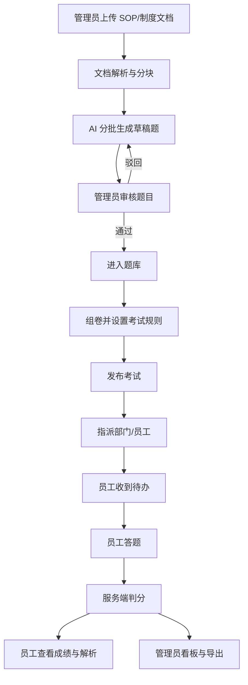
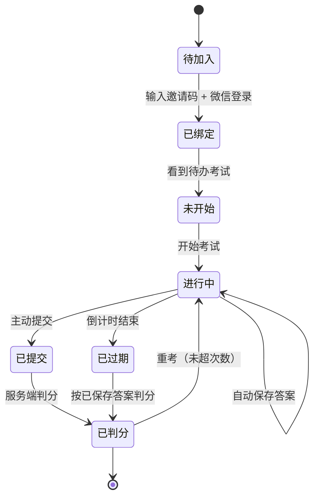

# 企业培训考核版需求分析文档

> 版本：V1.1
>
> 日期：2026-11-02
>
> 状态：待评审
>
> 变更：V1.1 按 B 方案（学习 + 考核闭环）补充员工端“学 → 练 → 考 → 评 → 再练”闭环，新增考前知识卡与错题重练。
>
> 关联文档：
> - 《需求分析文档》
> - 《方案设计文档》
> - 《企业方向可行性报告》
> - 《企业方向转型实施方案》

---

## 1. 文档目标

本文档定义“智训云”从 C 端学习工具转向**企业培训考核产品**后的需求边界，用于：

1. 冻结 MVP 做什么、不做什么。
2. 对齐产品、开发、设计和试点客户的理解。
3. 作为后续接口设计、页面设计、测试用例和验收的依据。
4. 明确业务规则，避免开发阶段反复确认。

本文档只回答“做什么”和“验收标准”，不展开具体技术实现。技术方案见《企业方向转型实施方案》。

---

## 2. 项目背景与目标

### 2.1 背景

现有产品已经跑通“输入主题 → AI 出题 → 闯关答题 → 复盘报告”的闭环，具备：

- 文档解析与 RAG 知识库
- AI 结构化出题
- 单选、多选、判断三种题型
- 即时判题与解析
- 用户、历史记录、经验值
- AI 配图

这些能力可以直接复用到企业培训场景。企业版不应把小程序缩成“只能考试”的工具，而应保留“学、练、考、评”的闭环：考试承担合规，练习承担使用频率，资料承担学习价值，复盘承担效果证明。

企业客户的核心诉求不是“趣味学习”，而是：

1. 降低培训内容制作和出题成本。
2. 让员工完成培训并留下可查询的记录。
3. 用通过率、薄弱知识点等数据证明培训效果。

### 2.2 产品定位

> 企业上传 SOP、制度、产品资料，AI 自动生成培训题目和考前知识卡；管理员审核后发布学习内容与考试；员工在微信里学、练、考；系统给出成绩、薄弱点、错题和可导出的培训记录。

首个目标行业：**连锁零售 / 餐饮门店的 SOP 与合规培训**。该选择可在评审时替换，不影响产品结构。

### 2.3 业务目标

| 目标 | 指标 | 目标值 |
|---|---|---|
| 降低出题成本 | 管理员从上传文档到发布第一场考试 | ≤ 30 分钟 |
| 保证题目质量 | AI 生成题目人工审核通过率 | ≥ 70% |
| 提升培训完成率 | 指派员工的考试完成率 | ≥ 80% |
| 提升学习效果 | 考前知识卡查看率 / 错题重练率 | ≥ 60% / ≥ 50% |
| 验证付费意愿 | 试点客户愿意进入付费谈判 | ≥ 70% |
| 控制交付风险 | 试点期 P0 缺陷 | 0 |

P1 观察指标：员工周练习率 ≥ 40%，每日一练次周留存 ≥ 30%。

### 2.4 成功定义

MVP 成功的标准不是“功能齐全”，而是：

1. 1 家试点企业、50 名以上员工、3 场考试完整跑通。
2. 管理员愿意继续使用，员工能独立完成考试，并在考前查看知识卡、考后重练错题。
3. 培训负责人能用导出的成绩表向上汇报。
4. 团队能在 13–16 周内交付（2 人并行；1 人约 16–18 周），不出现范围失控。

---

## 3. 用户与角色

### 3.1 用户画像

| 角色 | 典型身份 | 核心诉求 | 使用端 |
|---|---|---|---|
| 平台运营 | 产品/运营人员 | 开通租户、查看整体使用情况、处理故障 | 管理后台 |
| 企业管理员 | 培训负责人、HR | 上传资料、审核题目、配置知识卡、发布考试、看成绩 | 管理后台 |
| 部门主管（P1） | 店长、区域经理 | 查看本部门考试进度和薄弱点 | 管理后台 |
| 员工 | 店员、一线员工 | 快速找到待办考试、考前速览、错题重练、看成绩 | 微信小程序 |

### 3.2 角色权限矩阵

| 功能 | 平台运营 | 企业管理员 | 部门主管（P1） | 员工 |
|---|---|---|---|---|
| 创建/停用租户 | ✅ | ❌ | ❌ | ❌ |
| 查看全部租户数据 | ✅ | ❌ | ❌ | ❌ |
| 管理部门与员工 | ❌ | ✅ | 查看本部门 | ❌ |
| 管理知识库 | ❌ | ✅ | ❌ | ❌ |
| 管理知识卡 | ❌ | ✅ | ❌ | ❌ |
| 发起 AI 出题 | ❌ | ✅ | ❌ | ❌ |
| 审核题目 | ❌ | ✅ | ❌ | ❌ |
| 创建/发布考试 | ❌ | ✅ | 本部门（P1） | ❌ |
| 指派考试 | ❌ | ✅ | 本部门（P1） | ❌ |
| 查看全部成绩 | ✅ | ✅ | 本部门 | 仅本人 |
| 导出成绩 | ❌ | ✅ | 本部门（P1） | ❌ |
| 参加考试 | ❌ | ❌ | ❌ | ✅ |
| 查看知识卡/错题 | ❌ | ❌ | ❌ | ✅ |
| 自由练习 | ❌ | ❌ | ❌ | ✅ |

> MVP 只实现平台运营、企业管理员、员工三种角色；部门主管权限放 P1。

---

## 4. 核心业务场景

### 4.1 场景一：新人上岗考核

- **触发**：新员工入职，管理员导入员工并指派“新人上岗”考试。
- **流程**：员工收到待办 → 考前速览知识卡 → 答题 → 提交 → 查看成绩和解析 → 错题重练。
- **结果**：管理员看到完成率、通过率；未通过员工进入补考名单。
- **关键要求**：考试必须能在手机上 10 分钟内完成；断网或退出后可继续。

### 4.2 场景二：门店 SOP 复训

- **触发**：总部更新 SOP，管理员上传新版本文档并生成题目。
- **流程**：AI 生成草稿题 → 管理员审核 → 发布复训考试 → 指派到全部门店。
- **结果**：按部门统计完成率和薄弱环节，导出给区域经理。
- **关键要求**：题目要能标注来源文档和章节，方便管理员核对。

### 4.3 场景三：食品安全 / 消防合规考试

- **触发**：季度或年度合规要求，必须留痕。
- **流程**：管理员建立固定题库 → 组卷 → 设定及格线和考试时间 → 指派 → 员工答题。
- **结果**：形成可导出的培训记录，包含姓名、工号、部门、成绩、是否通过、提交时间。
- **关键要求**：答案不能下发前端；成绩不能被重复提交刷分；记录不可随意删除。

### 4.4 场景四：考前速览与错题重练

- **触发**：员工收到考试待办，或上一次考试/练习答错题。
- **流程**：考前查看 3–5 张知识卡 → 进入考试 → 提交后看解析 → 错题进入错题列表 → 重练并标记掌握。
- **结果**：员工用更短时间准备考试；管理员看到通过率提升。
- **关键要求**：知识卡 3 分钟内读完；错题重练不影响原考试成绩。

### 4.5 场景五：自由练习（保留）

- **触发**：员工想学习某个主题，或管理员不指定考试。
- **流程**：输入一句话 → AI 出题 → 即时判题 → 生成复盘报告。
- **结果**：个人练习记录，不计入企业考试统计。
- **关键要求**：保留现有 C 端体验；企业版中作为次要入口，不干扰待办考试。

---

## 5. 业务流程

### 5.1 端到端流程



员工侧不是“收到待办 → 答题 → 结束”，而是一个轻量学习闭环：


### 5.2 管理员流程

1. 登录管理后台（租户编码 + 账号 + 密码）。
2. 维护部门树，导入员工，生成/导出邀请码。
3. 上传培训文档，等待解析完成。
4. 选择题库、题量、题型、难度，发起 AI 出题。
5. 在审核队列中逐题查看原文、编辑、通过或驳回。
6. 创建考试：选题、题量、及格线、时长、重考次数、时间窗口，并关联考前知识卡。
7. 发布考试并指派到部门或员工。
8. 在考试详情页查看进度和成绩，导出 Excel。

### 5.3 员工考试流程



### 5.4 关键状态机

**题目状态**

```text
草稿 draft → 通过 approved
草稿 draft → 驳回 rejected
通过 approved → 编辑后回到 draft
驳回 rejected → 编辑后回到 draft
```

**考试状态**

```text
草稿 draft → 已发布 published → 已关闭 closed
草稿 draft → 已删除（软删除）
已发布 published 不允许删除，只能关闭
```

**答题状态**

```text
进行中 in_progress → 已提交 submitted → 已判分 graded
进行中 in_progress → 已过期 expired → 已判分 graded
```

---

## 6. 功能需求

### 6.0 功能优先级总览

| 模块 | P0（MVP 必须） | P1（试点后） | P2（规模化） |
|---|---|---|---|
| 租户与组织 | 租户、部门、员工导入、邀请码 | 部门主管视图 | 多租户自助开通 |
| 账号权限 | 管理员登录、员工登录、角色 | 企业微信/钉钉登录 | SSO |
| 知识库 | 上传、解析、状态、删除 | 批量导入、增量更新 | 多知识库 |
| AI 出题 | 文档分批出题、知识卡生成、草稿、来源引用 | 从已有题库补充、难度自适应 | 行业题库包 |
| 题库审核 | 列表、编辑、通过/驳回、批量 | 审核意见统计 | 多人协作审核 |
| 考试管理 | 组卷、规则、发布、指派 | 定时发布、撤回 | 考试模板 |
| 员工学习与考试 | 待办、考前知识卡、答题、保存、断点续答、提交、错题重练 | 每日一练、知识点闯关、错题本 + 遗忘曲线、学习包、证书 | AI 资料问答、学习地图、团队学习 |
| 成绩看板 | 完成率、通过率、薄弱题、部门对比 | 趋势分析 | 自定义报表 |
| 导出 | Excel 成绩表 | 题目明细、部门报表 | API 对接 |
| 通知 | 站内通知（指派、成绩） | 微信订阅消息、截止提醒、学习内容通知 | 短信/企微 |
| 审计 | 关键操作日志 | 日志检索、导出 | 合规报表 |

---

### 6.1 租户与组织

| 编号 | 功能 | 优先级 | 需求说明 | 验收要点 |
|---|---|---|---|---|
| FR-ORG-01 | 租户创建 | P0 | 平台运营创建租户，填写企业名称、租户编码 | 编码唯一；创建后生成企业管理员账号 |
| FR-ORG-02 | 部门树 | P0 | 支持多级部门，增删改查、排序 | 支持 3 级以上；删除前校验是否有员工 |
| FR-ORG-03 | 员工列表 | P0 | 按部门、姓名、工号、状态筛选 | 1 万员工内列表可用 |
| FR-ORG-04 | 员工导入 | P0 | 上传 Excel，字段：工号、姓名、部门路径 | 单次最多 1000 行；失败行给出原因 |
| FR-ORG-05 | 邀请码 | P0 | 为员工生成一次性邀请码，支持导出和重置 | 8 位；30 天有效；绑定后失效 |
| FR-ORG-06 | 员工停用 | P0 | 停用后不能登录和参加新考试 | 历史成绩保留 |
| FR-ORG-07 | 部门主管视图 | P1 | 主管只看本部门及下级部门 | 权限隔离测试通过 |

**业务规则**

1. 员工工号在租户内唯一。
2. 部门路径使用 `/` 分隔，例如 `华东区/上海门店/徐汇店`。
3. 导入时部门不存在则自动创建；工号重复则跳过并提示。
4. 删除部门前必须先把员工转移到其他部门。
5. 邀请码只能绑定一个微信 openid；换微信需管理员重置。

---

### 6.2 账号与权限

| 编号 | 功能 | 优先级 | 需求说明 | 验收要点 |
|---|---|---|---|---|
| FR-AUTH-01 | 管理员登录 | P0 | 租户编码 + 账号 + 密码登录 | 连续 5 次失败限流 1 分钟 |
| FR-AUTH-02 | 员工登录 | P0 | 微信静默登录 + 邀请码绑定 | 绑定后下次免邀请码 |
| FR-AUTH-03 | 角色校验 | P0 | 接口按角色鉴权 | 越权返回 403 |
| FR-AUTH-04 | 会话管理 | P0 | 管理员 8 小时、员工 30 天过期 | 过期后重新登录 |
| FR-AUTH-05 | 密码修改 | P0 | 管理员可修改自己的密码 | 新密码长度 ≥ 8 位 |
| FR-AUTH-06 | 企业微信登录 | P1 | 支持企微 userid 登录 | 不影响小程序登录 |
| FR-AUTH-07 | SSO | P2 | 对接客户统一身份 | 按客户定制 |
| FR-AUTH-08 | 新增管理员 | P0 | 企业管理员创建同租户管理员账号 | 登录名唯一，密码 ≥ 8 位 |
| FR-AUTH-09 | 重置管理员密码 | P0 | 管理员重置同租户账号密码 | 不影响账号状态和历史记录 |

**业务规则**

1. 管理员密码使用 bcrypt 哈希存储，不允许明文。
2. 员工首次登录必须绑定邀请码；未绑定只能看到“加入企业”页。
3. 一个微信只能绑定一个租户的员工账号；跨租户需管理员处理。
4. 平台运营账号不绑定租户，仅用于内部运维。
5. 管理员登录名在租户内唯一，密码至少 8 位。
6. 不能停用当前登录账号，也不能停用租户内最后一个启用状态的管理员。
7. 重置密码只更新密码哈希，不改变账号状态和历史记录。

---

### 6.3 知识库

| 编号 | 功能 | 优先级 | 需求说明 | 验收要点 |
|---|---|---|---|---|
| FR-KB-01 | 文档上传 | P0 | 支持 PDF、Word（docx）、Markdown、TXT | 单文件 ≤ 20MB |
| FR-KB-02 | 解析状态 | P0 | 显示处理中、已就绪、解析失败 | 失败显示原因 |
| FR-KB-03 | 文档列表 | P0 | 文件名、类型、大小、状态、片段数、上传时间 | 支持删除 |
| FR-KB-04 | 删除文档 | P0 | 删除文档、向量和本地文件 | 已引用该文档的题目保留来源快照 |
| FR-KB-05 | 配额 | P0 | 默认 200 篇/租户、2GB/租户 | 超限给出提示 |
| FR-KB-06 | 批量导入 | P1 | 一次上传多个文件 | 逐个显示状态 |
| FR-KB-07 | 增量更新 | P1 | 重新上传新版本，保留历史 | 旧题目不受影响 |

**业务规则**

1. 文档解析在后台任务执行，不阻塞上传接口。
2. 解析失败时保留原文件，管理员可重试或删除。
3. 文档归属于租户，不归属于个人；员工端不显示上传入口。
4. 文档内容只用于本租户出题，不跨租户检索。

---

### 6.4 AI 出题

| 编号 | 功能 | 优先级 | 需求说明 | 验收要点 |
|---|---|---|---|---|
| FR-GEN-01 | 发起出题 | P0 | 选择题库/文档、题量、题型比例、难度 | 题量 10–50，默认 20 |
| FR-GEN-02 | 生成进度 | P0 | 显示排队、生成中、已完成、失败 | 失败可重试 |
| FR-GEN-03 | 分批覆盖 | P0 | 基于文档分块分批生成，覆盖全文 | 生成题目来源分布合理 |
| FR-GEN-04 | 来源引用 | P0 | 每题记录文档、页码/片段 | 审核页可查看原文 |
| FR-GEN-05 | 结构校验 | P0 | 校验题型、选项、答案、解析完整性 | 非法题目标为“待修复” |
| FR-GEN-06 | 去重 | P0 | 完全相同或高度相似的题干去重 | 重复题不进入题库 |
| FR-GEN-07 | 重新生成 | P0 | 对单题或整批重新生成 | 不影响已审核题目 |
| FR-GEN-08 | 难度分布 | P1 | 按简单/中等/困难比例生成 | 可配置比例 |
| FR-GEN-09 | 从题库补题 | P1 | 从已有题库按知识点补题 | 不重复 |

**业务规则**

1. AI 只生成**草稿题**，不能直接用于考试。
2. 默认题型比例：单选 60%、多选 20%、判断 20%，管理员可调整。
3. 判断题选项固定为 A 正确、B 错误。
4. 多选题正确答案至少 2 个。
5. 每道题必须包含：题干、选项、答案、解析、知识点、难度、来源引用。
6. 生成失败不能影响已有题库；失败原因写入任务记录。
7. 同一文档重复生成时，默认跳过已存在的相似题目。

---

### 6.5 题库与审核

| 编号 | 功能 | 优先级 | 需求说明 | 验收要点 |
|---|---|---|---|---|
| FR-QB-01 | 题库管理 | P0 | 创建、重命名、归档题库 | 题库属于租户 |
| FR-QB-02 | 题目列表 | P0 | 按状态、题型、难度、知识点筛选 | 分页 ≥ 20 条/页 |
| FR-QB-03 | 题目详情 | P0 | 查看题干、选项、答案、解析、来源 | 高亮正确答案 |
| FR-QB-04 | 编辑题目 | P0 | 修改题干、选项、答案、解析 | 修改已通过题目后回到草稿 |
| FR-QB-05 | 审核通过 | P0 | 单题通过，记录审核人和时间 | 通过后可被组卷 |
| FR-QB-06 | 审核驳回 | P0 | 填写驳回原因 | 驳回原因可统计 |
| FR-QB-07 | 批量审核 | P0 | 多选题目批量通过/驳回 | 一次最多 50 题 |
| FR-QB-08 | 删除题目 | P0 | 软删除，保留审计 | 已被考试引用的题目不可硬删除 |
| FR-QB-09 | 审核意见 | P1 | 统计高频驳回原因 | 用于优化 Prompt |
| FR-QB-10 | Excel 题库导入 | P1 | 导入客户已有题库 | 模板校验、错误行提示 |

**业务规则**

1. 只有 `approved` 题目可以被组卷。
2. 编辑 `approved` 题目后状态变为 `draft`，必须重新审核。
3. 已发布考试使用题目快照，题库修改不影响已发布考试。
4. 审核人不能审核自己生成的题目？MVP 暂不限制，P1 可加。
5. 题目选项 key 必须唯一；答案必须是选项 key 的子集。
6. 判断题只能有 A、B 两个选项。

---

### 6.6 考试管理

| 编号 | 功能 | 优先级 | 需求说明 | 验收要点 |
|---|---|---|---|---|
| FR-EXAM-01 | 创建考试 | P0 | 标题、描述、题库、题量、及格线、时长、重考次数、关联知识卡 | 保存为草稿 |
| FR-EXAM-02 | 组卷 | P0 | 从已通过题目中抽题，支持手动调整 | 题量与分值一致 |
| FR-EXAM-03 | 考试时间窗 | P0 | 设置开始、结束时间 | 窗外不能开始 |
| FR-EXAM-04 | 发布考试 | P0 | 校验题目、生成快照、状态变为已发布 | 发布后员工可见 |
| FR-EXAM-05 | 指派 | P0 | 按部门或员工指派 | 指派记录可查 |
| FR-EXAM-06 | 关闭考试 | P0 | 关闭后不能再参加 | 已提交成绩保留 |
| FR-EXAM-07 | 考试列表 | P0 | 按状态、时间筛选 | 显示完成率 |
| FR-EXAM-08 | 定时发布 | P1 | 到时间自动发布 | 失败有告警 |
| FR-EXAM-09 | 撤回指派 | P1 | 撤回未开始的员工 | 已开始的不受影响 |

**业务规则**

1. 考试题量范围 5–100，默认 20。
2. 及格线 0–100，默认 60。
3. 时长 5–180 分钟，默认 30 分钟。
4. 重考次数 1–5，默认 1。
5. 发布时必须至少有 1 道已通过题目；题量不能超过题库可用题数。
6. 发布时冻结题目快照；后续题库修改不影响本场考试。
7. 已发布考试不能删除，只能关闭。
8. 指派按部门展开到员工；新入职员工不会自动加入，需要管理员重新指派。

---

### 6.7 员工学习与考试

员工端不是“只能考试”。MVP 包含 **考前知识卡 → 考试 → 成绩解析 → 错题重练** 的轻量闭环；自由练习保留为独立入口。

#### 6.7.1 考试流程

| 编号 | 功能 | 优先级 | 需求说明 | 验收要点 |
|---|---|---|---|---|
| FR-ATT-01 | 待办列表 | P0 | 显示未开始、进行中、已完成 | 按截止时间排序 |
| FR-ATT-02 | 开始考试 | P0 | 校验指派、时间窗、重考次数 | 返回无答案试卷 |
| FR-ATT-03 | 答题 | P0 | 单选、多选、判断 | 选项状态清晰 |
| FR-ATT-04 | 自动保存 | P0 | 选择后 500ms 防抖保存 | 退出后可恢复 |
| FR-ATT-05 | 断点续答 | P0 | 重新进入恢复题目和已选答案 | 倒计时以服务端为准 |
| FR-ATT-06 | 答题卡 | P0 | 显示已答/未答/当前题 | 可快速跳转 |
| FR-ATT-07 | 提交 | P0 | 二次确认；未答题提示 | 提交后不可修改 |
| FR-ATT-08 | 超时 | P0 | 到时自动提交已保存答案 | 服务端校验时间 |
| FR-ATT-09 | 成绩页 | P0 | 分数、是否通过、答对/答错数 | 展示正确答案和解析 |
| FR-ATT-10 | 重考 | P0 | 未超次数可重新开始 | 保留每次成绩 |
| FR-ATT-11 | 证书 | P1 | 通过后生成证书 | 可保存图片 |
| FR-ATT-12 | 切屏检测 | P1 | 记录切屏次数，超限提醒 | 不作为判分依据 |

#### 6.7.2 考前知识卡与学习内容

| 编号 | 功能 | 优先级 | 需求说明 | 验收要点 |
|---|---|---|---|---|
| FR-CARD-01 | 知识卡生成 | P0 | 管理员从文档/章节生成 3–5 张知识卡，AI 提炼要点 | 单卡 1 分钟内读完，一组 3–5 张卡 3 分钟内读完 |
| FR-CARD-02 | 知识卡审核 | P0 | 管理员编辑、删除、发布知识卡 | 未发布卡片员工不可见 |
| FR-CARD-03 | 考前速览 | P0 | 考试可关联一组知识卡，员工考前查看 | 考试页显示“考前速览”入口 |
| FR-CARD-04 | 阅读记录 | P0 | 记录员工是否查看知识卡 | 管理员可看查看率 |
| FR-CARD-05 | 学习资料 | P1 | 管理员发布文档/摘要，员工只读 | 按部门可见 |
| FR-CARD-06 | 学习包 | P1 | 资料 + 知识卡 + 练习 + 考试组成学习包 | 员工按学习包完成任务 |
| FR-CARD-07 | 学习进度 | P1 | 记录资料/知识卡完成状态 | 可在“我的”查看 |

#### 6.7.3 错题重练

| 编号 | 功能 | 优先级 | 需求说明 | 验收要点 |
|---|---|---|---|---|
| FR-WRONG-01 | 错题收集 | P0 | 考试和练习答错的题自动进入个人错题列表 | 记录来源、错误次数、最近错误时间 |
| FR-WRONG-02 | 错题列表 | P0 | 按知识点、最近错误时间筛选 | 只本人可见 |
| FR-WRONG-03 | 错题重练 | P0 | 重做错题，提交后显示答案与解析 | 不改变原考试成绩 |
| FR-WRONG-04 | 掌握标记 | P0 | 连续答对 2 次可标记“已掌握” | 可手动取消掌握 |
| FR-WRONG-05 | 遗忘曲线复习 | P1 | 按 1/3/7/14 天提醒复习 | 可关闭提醒 |
| FR-WRONG-06 | 每日一练 | P1 | 每天从已通过题库抽 3–5 题 | 不影响考试统计 |
| FR-WRONG-07 | 知识点闯关 | P1 | 按知识点生成练习关卡 | 复用现有闯关 UI |

#### 6.7.4 学习扩展

| 编号 | 功能 | 优先级 | 需求说明 | 验收要点 |
|---|---|---|---|---|
| FR-LEARN-01 | AI 资料问答 | P2 | 员工针对已发布资料提问，回答带引用 | 必须显示“仅供参考” |
| FR-LEARN-02 | 学习地图 | P2 | 按岗位/部门展示学习路径 | 管理员可配置 |
| FR-LEARN-03 | 团队学习 | P2 | 班组学习任务、内部排行（可选） | 默认关闭，不公开个人排名 |

**业务规则**

1. 试卷接口不得返回答案和解析。
2. 同一员工同一考试只能有一个进行中的答题场次。
3. 提交后服务端判分；重复提交返回第一次结果，不重复计分。
4. 超时后按已保存答案判分；未保存的题目按未作答处理。
5. 重考取最佳成绩作为最终成绩；通过状态取任一次通过。
6. 考试结束后，未开始的员工不能再开始；进行中的员工可继续到超时。
7. 知识卡和考试共用同一份文档来源，但知识卡不包含考试答案。
8. 错题重练和自由练习不计入考试完成率、通过率。
9. 错题重练答对不修改原考试成绩，只更新掌握状态。
10. 员工只能看到已发布且在其可见范围内的知识卡和学习资料。

---

### 6.8 成绩与看板

| 编号 | 功能 | 优先级 | 需求说明 | 验收要点 |
|---|---|---|---|---|
| FR-STAT-01 | 考试概览 | P0 | 指派人数、完成人数、完成率、通过率、平均分 | 与明细一致 |
| FR-STAT-02 | 员工成绩列表 | P0 | 姓名、工号、部门、分数、是否通过、提交时间 | 支持筛选 |
| FR-STAT-03 | 题目正确率 | P0 | 每题答对人数、正确率 | 低于 60% 标红 |
| FR-STAT-04 | 薄弱知识点 | P0 | 按知识点聚合正确率 | 排序展示 |
| FR-STAT-05 | 部门对比 | P0 | 按部门统计完成率和通过率 | 支持下钻 |
| FR-STAT-06 | 知识卡查看率 | P0 | 关联知识卡的员工查看人数/应查看人数 | 与阅读记录一致 |
| FR-STAT-07 | 趋势分析 | P1 | 多次考试通过率变化 | 按周/月 |
| FR-STAT-08 | 自定义报表 | P2 | 客户自定义维度 | 按项目定制 |

**业务规则**

1. 完成率 = 已提交人数 / 指派人数。
2. 通过率 = 通过人数 / 已提交人数。
3. 平均分只统计已提交的场次。
4. 部门统计包含下级部门。
5. 数据实时性允许 1 分钟延迟；MVP 不做实时大屏。
6. 知识卡查看率 = 已查看至少一张关联知识卡的员工数 / 被指派考试的员工数。

---

### 6.9 导出

| 编号 | 功能 | 优先级 | 需求说明 | 验收要点 |
|---|---|---|---|---|
| FR-EXP-01 | 成绩导出 | P0 | 导出 Excel：工号、姓名、部门、分数、是否通过、提交时间、重考次数 | 1000 行 < 10 秒 |
| FR-EXP-02 | 异步导出 | P0 | 大数据量走后台任务，完成后下载 | 失败可重试 |
| FR-EXP-03 | 题目明细导出 | P1 | 每题正确率、选项分布 | 按需 |
| FR-EXP-04 | 部门报表导出 | P1 | 按部门汇总 | 按需 |
| FR-EXP-05 | API 对接 | P2 | 提供成绩查询接口 | 按客户定制 |

**业务规则**

1. 导出文件只包含当前租户、当前考试的数据。
2. 下载链接有效期 24 小时。
3. 导出动作写入审计日志。
4. 超过 1 万行分批导出或提示缩小范围。

---

### 6.10 通知

| 编号 | 功能 | 优先级 | 需求说明 | 验收要点 |
|---|---|---|---|---|
| FR-NOT-01 | 考试指派通知 | P0 | 员工收到站内通知 | 首页红点 |
| FR-NOT-02 | 成绩通知 | P0 | 判分后通知员工 | 可跳转成绩页 |
| FR-NOT-03 | 截止提醒 | P1 | 结束前 24 小时提醒未完成员工 | 只提醒一次 |
| FR-NOT-04 | 微信订阅消息 | P1 | 通过订阅消息推送 | 用户授权后发送 |
| FR-NOT-05 | 学习内容通知 | P1 | 新知识卡/学习资料发布时提醒 | 可关闭 |
| FR-NOT-06 | 短信/企微 | P2 | 按客户需求接入 | 按项目定制 |

**业务规则**

1. MVP 只做站内通知，不做强推送。
2. 通知已读状态按员工记录。
3. 通知内容不包含答案和敏感信息。

---

### 6.11 审计

| 编号 | 功能 | 优先级 | 需求说明 | 验收要点 |
|---|---|---|---|---|
| FR-AUD-01 | 操作日志 | P0 | 记录审核、发布、指派、导出、删除、重置邀请码 | 包含操作人、时间、对象 |
| FR-AUD-02 | 日志查询 | P1 | 按操作人、动作、时间筛选 | 分页 |
| FR-AUD-03 | 日志导出 | P2 | 导出审计报表 | 按需 |

**业务规则**

1. 审计日志只追加，不修改、不删除。
2. 日志保留至少 1 年；具体期限按合同约定。
3. 平台运营查看租户日志需记录访问行为。

---

### 6.12 自由练习（保留）

| 编号 | 功能 | 优先级 | 需求说明 | 验收要点 |
|---|---|---|---|---|
| FR-PRAC-01 | 自由输入 | P0 | 员工输入主题生成练习 | 不影响考试统计 |
| FR-PRAC-02 | 即时判题 | P0 | 练习模式保留前端即时反馈 | 保持现有体验 |
| FR-PRAC-03 | 练习历史 | P1 | 查看个人练习记录 | 与考试记录分开 |
| FR-PRAC-04 | 练习报告 | P1 | 保留现有复盘报告 | 不进入企业看板 |

**业务规则**

1. 练习记录不计入企业考试完成率和通过率。
2. 企业管理员默认看不到员工练习内容。
3. 练习模式可以匿名使用；登录后保存历史。

---

## 7. 业务规则汇总

### 7.1 题目规则

1. 题型：单选 `single`、多选 `multiple`、判断 `judge`。
2. 单选只有 1 个正确答案；多选至少 2 个；判断固定 A/B。
3. 选项 key 唯一，答案必须是选项 key 的子集。
4. 每题必须有解析、知识点、难度、来源引用。
5. 难度取值：`easy`、`medium`、`hard`。
6. 题干去重：标准化后完全相同或相似度 > 85% 视为重复。

### 7.2 判分与成绩

1. 单选/判断：答案集合完全相等。
2. 多选：必须与正确答案完全一致，少选、多选均判错（部分得分放 P1）。
3. 每题等分；总分 100 分，按正确题数比例折算。
4. 及格线默认 60 分，管理员可调整。
5. 最终成绩取最佳场次；通过状态取任一次通过。
6. 成绩一旦判分，不允许管理员手工修改；如需修正，走数据修复流程并留审计。

### 7.3 考试与重考

1. 考试时间窗、时长、重考次数由管理员设置。
2. 员工只能在时间窗内开始考试。
3. 进行中的考试可继续到超时；考试关闭不影响已开始的场次。
4. 重考次数用完后不能再次开始。
5. 已发布考试不能修改题目和规则；如需调整，关闭后新建考试。

### 7.4 邀请码与账号

1. 邀请码 8 位，30 天有效，一次性使用。
2. 绑定后邀请码失效；换微信需管理员重置。
3. 员工停用后不能登录，历史成绩保留。
4. 管理员密码至少 8 位，连续 5 次失败限流。
5. 平台运营账号不绑定租户。

### 7.5 数据可见性

1. 租户之间完全隔离，任何接口不能跨租户查询。
2. 员工只能看自己的考试、成绩、通知。
3. 部门主管只能看本部门及下级部门（P1）。
4. 企业管理员可以看本租户全部数据，但默认不看员工个人练习内容。
5. 员工只能看自己的错题和已发布的学习内容。
6. 平台运营可以看全部租户，但操作需审计。

### 7.6 配额与限制

| 项 | 默认值 | 说明 |
|---|---|---|
| 文档数/租户 | 200 篇 | 可配置 |
| 单文件大小 | 20MB | 可配置 |
| 总存储/租户 | 2GB | 可配置 |
| 单次出题 | 10–50 题 | 默认 20 |
| 单次员工导入 | 1000 行 | 超出分批 |
| 考试题量 | 5–100 题 | 默认 20 |
| 考试时长 | 5–180 分钟 | 默认 30 |
| 重考次数 | 1–5 次 | 默认 1 |
| 单次导出 | 10,000 行 | 超出分批 |

### 7.7 时间与时区

1. 所有时间按 `Asia/Shanghai` 存储和展示。
2. 考试时间窗精确到分钟。
3. 倒计时以服务端 `expires_at` 为准，前端只做展示。

### 7.8 学习与练习规则

1. 知识卡由管理员从文档生成并审核发布，未发布卡片员工不可见。
2. 知识卡不包含考试答案；考试答案只在提交后展示。
3. 错题来源包括考试和练习；重练不改变原考试成绩。
4. 错题连续答对 2 次标记为“已掌握”，员工可手动取消。
5. 每日一练、知识点闯关、自由练习不计入考试统计。
6. 学习内容和错题只在租户内可见，不跨租户共享。
7. AI 资料问答（P2）必须带来源引用和“仅供参考”提示。

---

## 8. 页面与交互需求

### 8.1 管理后台页面

| 页面 | 核心内容 | 关键交互 |
|---|---|---|
| 登录 | 租户编码、账号、密码 | 错误提示、限流提示 |
| 工作台 | 待审核题、进行中考试、完成率、通过率 | 点击跳转 |
| 组织架构 | 部门树、员工数 | 新增/编辑/删除部门 |
| 员工管理 | 列表、筛选、导入、邀请码 | Excel 导入、批量导出邀请码 |
| 知识库 | 文档列表、上传、解析状态 | 上传、重试、删除 |
| 出题任务 | 题库选择、题量、题型、难度、进度 | 发起、轮询、失败重试 |
| 题库审核 | 题目列表、原文对照、编辑 | 通过、驳回、批量操作 |
| 知识卡管理 | 卡片列表、来源文档、发布状态 | 生成、编辑、发布、下线 |
| 考试管理 | 考试列表、状态、完成率 | 创建、发布、关闭、关联知识卡 |
| 考试详情 | 指派范围、成绩列表、题目正确率、知识卡查看率 | 筛选、导出 |
| 导出中心 | 导出任务、下载链接 | 下载、重试 |
| 设置 | 租户信息、通知模板 | 保存 |

### 8.2 员工端页面

| 页面 | 核心内容 | 关键交互 |
|---|---|---|
| 加入企业 | 邀请码输入 | 绑定微信 |
| 学习（Tab） | 今日任务、待办考试、考前知识卡、继续学习 | 阅读知识卡、开始考试 |
| 练习（Tab） | 自由练习、错题重练、知识点闯关（P1）、每日一练（P1） | 开始练习、重练错题 |
| 我的（Tab） | 成绩、证书（P1）、学习记录、通知、部门信息 | 查看详情 |
| 考试答题 | 题干、选项、倒计时、答题卡 | 选择、保存、提交 |
| 考试成绩 | 分数、是否通过、逐题解析、错题重练入口 | 重考、重练错题 |
| 知识卡阅读 | 卡片、要点、来源 | 标记已读、进入考试 |
| 自由练习 | 主题输入、生成、答题 | 保留现有体验 |

### 8.3 通用状态

每个页面必须处理：

- 加载中
- 空状态
- 网络错误
- 无权限
- 数据过期（考试已关闭、邀请码失效、知识卡已下线）

### 8.4 体验要求

1. 员工端在 375px 宽度下不出现横向滚动。
2. 考试答题页首屏必须看到题干、选项和倒计时。
3. 一组知识卡要在 3 分钟内读完，单卡不超过一屏半。
4. 错题重练路径不超过 2 步：成绩页 → 错题 → 重练。
5. 管理后台适配 1366×768 及以上屏幕。
6. 危险操作（删除、发布、关闭）必须二次确认。
7. 关键操作给出明确结果提示，不用模糊的“操作成功”。

---

## 9. 数据需求

### 9.1 核心实体

| 实体 | 说明 |
|---|---|
| 租户 | 企业主体 |
| 部门 | 组织树节点 |
| 用户 | 平台运营、管理员、员工 |
| 管理员账号 | 管理后台登录账号，密码使用 bcrypt 哈希 |
| 知识库文档 | 上传的培训资料 |
| 题库 | 题目集合 |
| 题目 | 结构化题目与审核状态 |
| 知识卡 | 从文档提炼的考前速览要点 |
| 知识卡阅读记录 | 员工查看知识卡的时间与次数 |
| 学习资料 | 管理员发布给员工的只读文档/摘要 |
| 错题记录 | 员工考试/练习答错的题与掌握状态 |
| 考试 | 组卷与规则 |
| 考试题目快照 | 发布时冻结的题目 |
| 指派记录 | 考试与员工的关联 |
| 答题场次 | 员工每次考试 |
| 作答明细 | 每题选择与判分 |
| 通知 | 站内消息 |
| 审计日志 | 关键操作记录 |

### 9.2 导入导出格式

**员工导入 Excel**

| 列 | 必填 | 说明 |
|---|---|---|
| 工号 | 是 | 租户内唯一 |
| 姓名 | 是 | 显示名称 |
| 部门路径 | 是 | 例如 `华东区/上海门店/徐汇店` |
| 手机号 | 否 | 仅用于联系，MVP 不登录 |
| 角色 | 否 | 默认员工 |

**成绩导出 Excel**

| 列 | 说明 |
|---|---|
| 工号 | 员工工号 |
| 姓名 | 员工姓名 |
| 部门 | 完整路径 |
| 分数 | 最佳成绩 |
| 是否通过 | 是/否 |
| 提交时间 | 最佳成绩的提交时间 |
| 重考次数 | 已用次数 |
| 状态 | 已完成/未完成 |

### 9.3 数据保留

1. 考试记录和成绩至少保留 3 年，具体以合同为准。
2. 审计日志至少保留 1 年。
3. 删除文档时保留题目来源快照，不保留原文件。
4. 租户停用后数据保留 90 天，之后按合同删除或归档。

### 9.4 埋点与指标

| 事件 | 触发时机 | 用途 |
|---|---|---|
| `tenant_created` | 创建租户 | 激活漏斗 |
| `employee_imported` | 导入员工 | 激活漏斗 |
| `document_uploaded` | 上传文档 | 使用深度 |
| `question_generation_started` | 发起出题 | 使用深度 |
| `question_generation_completed` | 出题完成 | 成功率 |
| `question_approved` | 审核通过 | 质量指标 |
| `exam_published` | 发布考试 | 核心激活 |
| `exam_assigned` | 指派考试 | 使用深度 |
| `knowledge_card_viewed` | 员工查看知识卡 | 考前学习率 |
| `attempt_started` | 开始答题 | 完成率漏斗 |
| `attempt_submitted` | 提交答卷 | 完成率漏斗 |
| `wrong_question_added` | 错题进入列表 | 错题覆盖率 |
| `wrong_question_retried` | 员工重练错题 | 学习闭环 |
| `wrong_question_mastered` | 错题标记掌握 | 学习效果 |
| `practice_started` | 开始自由练习/每日一练 | 使用频率 |
| `practice_completed` | 完成练习 | 使用频率 |
| `export_completed` | 导出完成 | 价值验证 |

**核心指标**

1. 激活：租户创建后 24 小时内发布第一场考试。
2. 首次价值时间：上传文档到发布考试 ≤ 30 分钟。
3. AI 出题成功率 ≥ 95%。
4. 审核通过率 ≥ 70%。
5. 考试完成率 ≥ 80%。
6. 考前知识卡查看率 ≥ 60%。
7. 错题重练率 ≥ 50%。
8. 管理员周活跃 ≥ 60%。
9. P1 观察：员工周练习率 ≥ 40%，每日一练次周留存 ≥ 30%。

---

## 10. 非功能需求

### 10.1 性能

| 项 | 要求 |
|---|---|
| 普通 API 响应 | P95 < 500ms |
| 考试试卷加载 | < 1 秒 |
| 知识卡/错题列表加载 | < 1 秒 |
| 20 题 AI 生成 | P90 < 3 分钟 |
| 10MB 文档解析 | < 2 分钟 |
| 1000 行成绩导出 | < 10 秒 |
| 管理后台列表 | 1 万条内 < 1 秒 |

### 10.2 并发与容量

1. 试点期支持 100 人同时考试。
2. 单租户支持 1 万名员工、200 篇文档。
3. 后续 SaaS 化支持 500 人同时考试，按需扩容。

### 10.3 可用性

1. 试点期可用性 ≥ 99.5%。
2. 每日备份 MySQL；RPO ≤ 24 小时，RTO ≤ 4 小时。
3. 出题、解析、导出任务失败可重试，不丢失任务记录。

### 10.4 安全

1. 全站 HTTPS。
2. 租户数据严格隔离。
3. 管理员密码哈希存储，登录限流。
4. 考试答案不下发前端；提交幂等。
5. 关键操作审计。
6. 错题和知识卡按租户/个人隔离；员工只能看自己的错题。
7. 文件上传校验类型和大小；解析任务隔离执行。
8. 不在日志中记录密码、token、完整身份证号等敏感信息。

### 10.5 合规

1. 微信小程序类目和资质提前确认。
2. 完成 ICP 备案、域名白名单、隐私协议。
3. AI 生成内容标注“AI 生成，需审核”。
4. 与企业客户签署数据处理协议。
5. 员工数据只用于培训考核，不用于模型训练。

### 10.6 兼容性

1. 员工端：微信 iOS/Android 最近两个大版本。
2. 管理后台：Chrome/Edge 最近两个大版本，1366×768 及以上。
3. 不要求管理后台适配手机。

### 10.7 可维护性

1. 结构化日志包含 `request_id`、`tenant_id`、`user_id`。
2. 关键链路有错误追踪。
3. 核心业务逻辑有单元测试和集成测试。
4. 数据库变更通过迁移脚本管理。

---

## 11. MVP 边界与优先级

### 11.1 P0（MVP 必须）

- 租户、部门、员工导入、邀请码
- 管理员登录、员工微信登录、角色权限
- 知识库上传、解析、状态、删除
- AI 文档分批出题、草稿、来源引用
- 题库审核、编辑、通过/驳回、批量
- 考试创建、组卷、发布、指派、关闭
- 员工待办、答题、保存、断点续答、提交
- 考前知识卡、知识卡阅读记录
- 错题收集、错题列表、错题重练、掌握标记
- 服务端判分、成绩页、重考
- 考试看板、题目正确率、部门对比
- Excel 成绩导出
- 站内通知、审计日志
- 自由练习保留

### 11.2 P1（试点后）

- 部门主管视图
- 企业微信/钉钉登录
- 微信订阅消息、截止提醒、学习内容通知
- 每日一练、知识点闯关
- 错题本 + 遗忘曲线复习
- 学习包、学习资料、学习进度
- 证书
- 多选部分得分
- 选项乱序、切屏检测
- Excel 题库导入
- 趋势分析
- 批量文档导入、增量更新

### 11.3 P2（规模化）

- 多租户自助开通
- 私有化一键部署
- LMS/HR API、SSO
- 行业题库包
- AI 资料问答（带引用）
- 学习地图、团队学习
- 自定义报表
- 短信/企微通知

### 11.4 明确不做

- 实时对战、直播答题、公开排行榜
- 课程商城、社区 Feed、直播课程
- 在线支付、发票、订阅管理
- 摄像头监考、活体检测
- 多语言
- 独立 App

---

## 12. 验收标准

### 12.1 功能验收

- [ ] 管理员能创建部门、导入 100 名员工、导出邀请码。
- [ ] 员工能用邀请码绑定微信，下次免邀请码登录。
- [ ] 管理员能上传 5 份文档并看到解析状态。
- [ ] 管理员能发起 20 题生成任务，看到进度和失败原因。
- [ ] 管理员能从文档生成并发布 3–5 张知识卡。
- [ ] 审核页能查看题目和原文来源，支持通过/驳回/批量。
- [ ] 管理员能组卷、发布、指派到部门和员工。
- [ ] 员工能看到待办，开始考试，答题，退出后继续。
- [ ] 管理员能为考试关联考前知识卡，员工考前能查看并记录阅读状态。
- [ ] 管理员能在考试详情看到知识卡查看率。
- [ ] 考试和练习答错的题自动进入错题列表，员工能重练并看解析。
- [ ] 错题重练不改变原考试成绩，连续答对可标记掌握。
- [ ] 提交后能看到分数、是否通过、逐题解析。
- [ ] 超时自动提交，按已保存答案判分。
- [ ] 管理员看板的完成率、通过率与明细一致。
- [ ] 能导出 Excel，字段完整。
- [ ] 租户 A 无法访问租户 B 的任何数据。
- [ ] 审计日志能查到发布、审核、导出、重置邀请码。

### 12.2 UAT 场景

| 编号 | 场景 | 预期 |
|---|---|---|
| UAT-01 | 管理员从零建一场新人考试 | 30 分钟内完成 |
| UAT-02 | 员工中途退出再进入 | 答案和倒计时恢复 |
| UAT-03 | 员工超时未提交 | 自动判分，未答题按错处理 |
| UAT-04 | 管理员修改已通过题目 | 状态回到草稿，已发布考试不受影响 |
| UAT-05 | 同一员工重复提交 | 返回第一次结果，不重复计分 |
| UAT-06 | 员工用完重考次数 | 不能再次开始 |
| UAT-07 | 管理员导出 1000 行成绩 | 10 秒内完成 |
| UAT-08 | 租户 B 管理员访问租户 A 资源 | 403/404 |
| UAT-09 | 网络中断时保存答案 | 本地保留，恢复后同步 |
| UAT-10 | AI 生成失败 | 任务显示失败原因，可重试 |
| UAT-11 | 员工考前查看知识卡 | 一组 3–5 张卡 3 分钟内读完，阅读状态被记录 |
| UAT-12 | 考试答错后重练 | 错题出现，重练答对后标记掌握，原成绩不变 |
| UAT-13 | 自由练习/错题重练 | 不计入考试完成率和通过率 |

### 12.3 试点验收

- [ ] 1 家客户、50+ 员工、3 场考试完成。
- [ ] 完成率 ≥ 80%。
- [ ] 题目审核通过率 ≥ 70%。
- [ ] 考前知识卡查看率 ≥ 60%，错题重练率 ≥ 50%。
- [ ] 管理员愿意进入付费谈判。
- [ ] P0 缺陷清零，P1 缺陷有排期。

---

## 13. 风险与依赖

### 13.1 依赖

| 依赖 | 说明 | 责任方 |
|---|---|---|
| 微信小程序 AppID/Secret | 员工登录、发布 | 客户/我方 |
| DeepSeek API | 出题、报告 | 我方 |
| Tavily API（可选） | 联网补充 | 我方 |
| 百炼 Embedding/生图（可选） | 知识库、配图 | 我方 |
| MySQL / Redis | 数据与队列 | 我方/云服务 |
| 域名、SSL、ICP | 上线 | 我方 |
| 客户培训文档 | 出题素材 | 客户 |
| 客户员工名单 | 组织导入 | 客户 |

### 13.2 风险

| 风险 | 影响 | 应对 |
|---|---|---|
| 客户文档格式混乱 | 解析失败、出题质量差 | 提供模板；先支持主流格式；失败给明确原因 |
| AI 题目质量不稳定 | 审核成本高 | 来源引用、黄金集、重试、人工审核 |
| 知识卡/学习内容供给不足 | 员工端仍像考试工具 | P0 用 AI 从现有文档生成知识卡；P1 再做学习包 |
| 管理后台工作量超预期 | 延期 | ProComponents；先做核心 6 页 |
| 微信类目/审核不通过 | 无法上线 | 提前准备材料；必要时 H5 过渡 |
| 客户不愿导入员工 | 试点受阻 | Excel 模板 + 一键邀请码；先用部门账号试跑 |
| 数据安全质疑 | 一票否决 | 租户隔离、审计、私有化选项、数据协议 |
| 范围蔓延 | 交付失控 | MVP 清单冻结；新需求进 P1 |
| 销售周期长 | 现金流压力 | 先试点/项目制，不提前扩团队 |

---

## 14. 待确认事项

以下事项需要在评审时确认；未确认前按“默认建议”执行。

| 编号 | 事项 | 默认建议 | 影响 |
|---|---|---|---|
| Q1 | 首个行业 | 连锁零售/餐饮 | 题库模板、试点名单、销售话术 |
| Q2 | 管理后台形态 | 独立 React Web | 前端工作量、技术栈 |
| Q3 | 员工绑定方式 | 邀请码 | 是否需要短信服务 |
| Q4 | 部署方式 | 单租户云托管 | 私有化成本、交付周期 |
| Q5 | 是否保留自由练习 | 保留，作为次要入口 | 员工端信息架构 |
| Q6 | 是否支持 Excel 题库导入 | P1 | 已有题库客户的迁移成本 |
| Q7 | 多选是否部分得分 | MVP 不支持 | 判分规则、客户预期 |
| Q8 | 是否需要证书 | P1 | 合规客户吸引力 |
| Q9 | 租户品牌定制 | P1 | 白标客户需求 |
| Q10 | 数据保留期限 | 合同期 + 90 天 | 存储成本、合规 |
| Q11 | 员工端学习闭环范围 | P0 考前知识卡 + 错题重练；P1 每日一练、学习包 | 员工端工作量 |
| Q12 | 知识卡是否需要管理员审核 | 需要 | 内容准确性、审核成本 |
| Q13 | 错题重练是否影响考试成绩 | 不影响 | 判分与产品预期 |

---

## 15. 术语表

| 术语 | 含义 |
|---|---|
| 租户 | 一个企业客户的数据边界 |
| 部门树 | 企业组织架构 |
| 邀请码 | 员工绑定微信的一次性凭证 |
| 题库 | 题目的集合，可被考试引用 |
| 知识卡 | 从文档提炼的考前速览要点 |
| 错题重练 | 对考试/练习错题重新作答，不影响原成绩 |
| 组卷 | 从题库选择题目组成考试 |
| 题目快照 | 发布考试时冻结的题目内容 |
| 答题场次 | 员工一次完整的考试尝试 |
| 断点续答 | 退出后重新进入继续答题 |
| 完成率 | 已提交人数 / 指派人数 |
| 通过率 | 通过人数 / 已提交人数 |
| 黄金集 | 用于评估出题质量的标准题目集合 |

---

## 附录 A：与现有功能的差异

| 现有能力 | 企业版变化 |
|---|---|
| 微信静默登录 | 增加租户编码、邀请码绑定、角色 |
| 首页自由输入 | 改为“学习 / 练习 / 我的”三 Tab，考试作为学习任务 |
| 前端本地判题 | 考试模式服务端判分；练习模式保留本地判分 |
| 个人知识库上传 | 改为管理员上传，员工只读 |
| 无考前学习内容 | 新增考前知识卡（P0）、学习包（P1） |
| 无错题功能 | 新增错题收集、错题重练、掌握标记（P0） |
| 个人历史与经验值 | 增加部门、考试记录、成绩看板；弱化游戏化 |
| AI 报告 | 考试成绩页 + 个人复盘 + 可选 AI 聚合报告 |
| 单用户数据 | 租户、部门、角色、数据隔离 |
| 进程内异步任务 | 队列 + Worker |
| 无管理后台 | 新增 PC 管理后台 |
| 启动自动建表 | Alembic 迁移 |

---

## 附录 B：需求评审检查清单

- [ ] 业务目标与试点指标是否认可？
- [ ] 首个行业和考试模板是否确定？
- [ ] 角色权限矩阵是否符合客户实际？
- [ ] 员工端“学 → 练 → 考 → 评 → 再练”闭环是否认可？
- [ ] 员工绑定方式是否可接受？
- [ ] 题目审核流程是否足够轻？
- [ ] 考试规则（及格线、时长、重考）是否符合合规要求？
- [ ] 成绩导出字段是否满足客户汇报？
- [ ] 数据保留和隐私条款是否明确？
- [ ] MVP 边界是否冻结，P1 需求是否进入池子？
- [ ] 13–16 周排期（2 人并行）或 16–18 周（1 人）与团队投入是否匹配？
