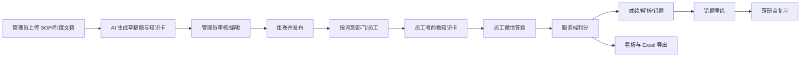
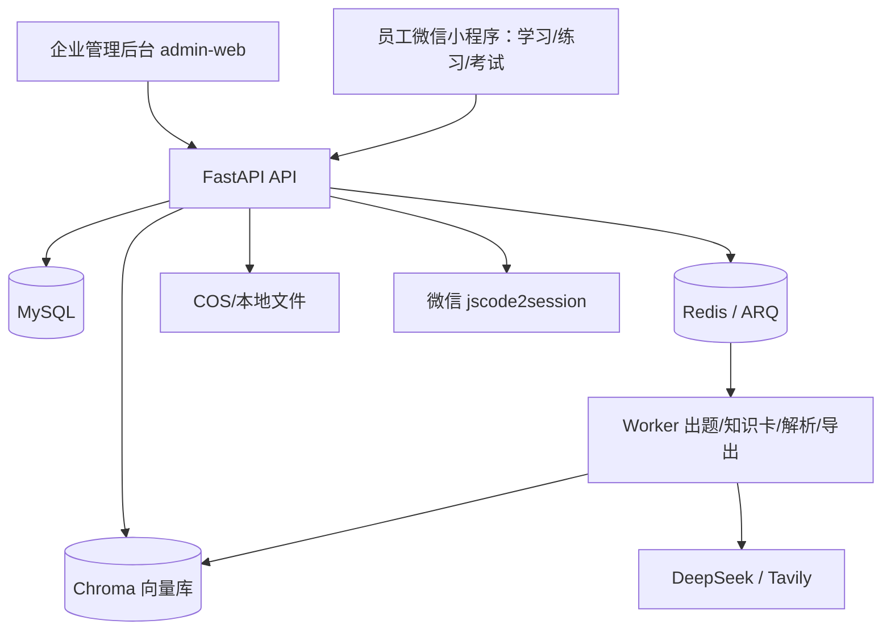
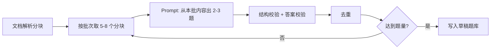
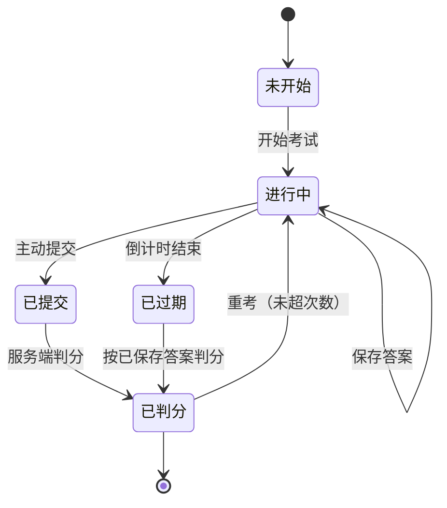
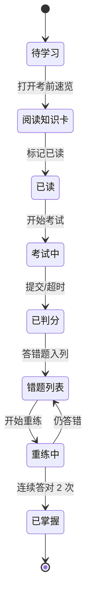

# 企业方向转型实施方案

> 版本：V1.1
>
> 日期：2026-11-02
>
> 依据：《企业方向可行性报告》《企业培训考核版需求分析文档》
>
> 目标：在保留现有 AI 出题、知识库 RAG、报告与闯关引擎的前提下，把项目转成一个可交付的**单租户企业学习与考核产品**，并为后续多租户 SaaS 预留结构。
>
> 变更：V1.1 按 B 方案补充员工端“学 → 练 → 考 → 评 → 再练”闭环，新增考前知识卡、错题重练及对应数据模型、接口与页面。

---

## 0. 结论与默认假设

### 0.1 方案结论

- **产品形态**：员工端继续用微信小程序，承载“学习 / 练习 / 考试”闭环；新增独立的 PC 管理后台；后端补组织、题库审核、知识卡、考试、判分、错题、看板、导出。
- **员工端定位**：考试负责合规留痕，知识卡负责考前准备，错题重练负责考后复盘；不做成纯考试工具。
- **交付形态**：先做单租户（一个客户一套部署或一个租户），数据库结构从一开始带 `tenant_id`，避免二次改造。
- **排期**：1–2 人，MVP 约 **13–16 周**（2 人并行）；1 人顺序执行约 **16–18 周**。相比纯考试版增加约 1–2 周，用于知识卡和错题重练。
- **首单目标**：1 个细分行业、1–2 家种子客户、50–200 名员工、3 套考试。

### 0.2 默认假设（可替换）

| 项 | 默认选择 | 说明 |
|---|---|---|
| 首个行业 | 连锁零售 / 餐饮门店的 SOP 与合规培训 | 门店多、人员流动大、SOP 重复培训多、决策链短 |
| 管理后台 | 独立 `admin-web`，React + Vite + Ant Design | PC 端表格、表单、审核流更适合 Web |
| 员工端 | 保留 Taro 微信小程序 | 扫码即用，适合门店员工 |
| 员工端信息架构 | 学习 / 练习 / 我的三 Tab | 考试是学习任务，不是唯一入口 |
| 租户模型 | 共享库 + `tenant_id`，单租户部署 | 成本低，后续可平滑升级 SaaS |
| 任务队列 | ARQ + Redis | 与现有 async 技术栈一致；团队更熟 Celery 也可替换 |
| 考试判分 | 服务端判分 | 考试答案不下发前端 |
| 登录方式 | 员工：微信静默登录 + 邀请码绑定；管理员：账号密码 + JWT | 企业微信/钉钉登录放 P1 |
| 团队 | 1–2 人 | 1 人约 16–18 周，2 人约 13–16 周 |

### 0.3 MVP 明确不做

- 不做通用多租户自助 SaaS（先做单租户交付）。
- 不做实时对战、公开排行榜。
- 不做支付、发票、套餐订阅系统（先线下合同）。
- 不做企业微信/钉钉深度集成（P1）。
- 不做复杂防作弊（摄像头监考、活体检测）。
- 不做课程商城、直播课程、社区 Feed。
- 不做多语言、多端 App。

---

## 1. 产品定义与 MVP 范围

### 1.1 一句话定位

> 企业把 SOP、制度、产品资料上传后，AI 自动生成培训题目和考前知识卡，管理员审核后发布学习内容与考试，员工在微信里学、练、考，系统给出成绩、薄弱点、错题和可导出的培训记录。

### 1.2 角色

| 角色 | 使用端 | 核心权限 |
|---|---|---|
| 平台运营 | 管理后台 | 创建租户、查看全局数据、运维 |
| 企业管理员 | 管理后台 | 组织/员工、知识库、知识卡、题库审核、考试发布、成绩导出 |
| 部门主管（P1） | 管理后台 | 查看本部门考试与成绩 |
| 员工 | 微信小程序 | 考前看知识卡、参加考试、查看成绩与解析、错题重练 |

### 1.3 核心闭环



### 1.4 MVP 功能清单（P0）

| 模块 | 能力 | 验收标准 |
|---|---|---|
| 租户与组织 | 租户、部门树、员工导入 | 管理员可导入 100 名员工并按部门查看 |
| 员工绑定 | 邀请码 + 微信登录 | 员工输入邀请码后绑定 openid，后续免输 |
| 知识库 | 上传 PDF/Word/MD/TXT、解析、状态 | 10MB 文档 2 分钟内完成解析 |
| AI 出题 | 基于文档分批生成草稿题、带来源引用 | 20 题任务 3 分钟内完成，JSON 成功率 ≥ 95% |
| AI 知识卡 | 基于文档生成 3–5 张考前知识卡、带来源引用 | 管理员可审核发布；单卡 1 分钟内读完，一组 3 分钟内读完 |
| 题库审核 | 列表、筛选、编辑、通过/驳回、批量操作 | 管理员 10 分钟内完成 20 题审核 |
| 知识卡审核 | 列表、编辑、发布/下线 | 管理员 10 分钟内完成 5 张卡审核 |
| 考试 | 组卷、发布、指派、截止时间 | 发布后员工端 1 分钟内可见 |
| 员工学习 | 考前知识卡、错题重练、掌握标记 | 一组知识卡 3 分钟读完；错题重练不改原成绩 |
| 员工答题 | 计时、断点续答、提交 | 断网/退出后回来可继续 |
| 服务端判分 | 单选/多选/判断、及格线、重考次数 | 前端拿不到答案，提交后返回结果 |
| 成绩与看板 | 完成率、通过率、平均分、薄弱题、知识卡查看率 | 数据与明细一致 |
| 导出 | Excel 成绩表 | 1000 行导出 < 10 秒 |
| 审计 | 关键操作日志 | 可查谁在何时发布了哪场考试 |

### 1.5 后续版本

- P1：部门主管视图、企业微信登录、消息提醒、每日一练、知识点闯关、错题本 + 遗忘曲线、学习资料、学习包、学习进度、证书、题目部分得分、选项乱序、切屏检测。
- P2：多租户自助开通、私有化一键部署、LMS/HR API、行业题库包、AI 资料问答、学习地图、团队学习、AI 聚合报告。

---

## 2. 总体架构

### 2.1 目标架构



### 2.2 改造原则

1. **核心引擎不动**：出题、RAG、报告、计分逻辑继续复用，包一层企业业务。
2. **考试是合规锚点**：考试负责留痕和通过率，知识卡与错题重练负责使用频率和学习效果。
3. **答案不下发**：考试模式由服务端判分；练习模式保留前端即时判分。
4. **租户字段贯穿**：主业务表、查询、缓存、文件路径都带 `tenant_id`；子表通过父表校验租户。
5. **异步任务出进程**：出题、知识卡、文档解析、导出统一走队列，避免进程重启丢任务。
6. **内容先审核后使用**：AI 只产出草稿题和草稿知识卡，不直接进入考试或员工端。
7. **先单租户交付，后多租户 SaaS**：结构预留，部署不提前复杂化。

### 2.3 技术选型变化

| 层 | 现状 | 转型后 | 原因 |
|---|---|---|---|
| 管理后台 | 无 | React 18 + Vite + Ant Design 5 + TanStack Query | PC 表格/表单/审核流 |
| 员工端信息架构 | 首页 = 待办考试 | 学习 / 练习 / 我的三 Tab | 提升使用频率，保留闯关能力 |
| 学习内容 | 无 | 考前知识卡（P0）、学习包（P1） | 让员工考前有准备、考后有复盘 |
| 队列 | `asyncio.create_task` | ARQ + Redis | 重启不丢任务，可横向扩容 |
| 迁移 | 启动自动建表 | Alembic | 生产环境可控升级 |
| 向量库 | 本地 Chroma 目录 | Chroma Server（单机也可嵌入） | API 与 Worker 共享 |
| 认证 | JWT + openid | JWT 增加 `tenant_id`/`role`；管理员密码登录 | 角色与租户隔离 |
| 判分 | 前端本地 | 考试服务端判分 | 公平性与防作弊 |
| 文件 | 本地 `data/uploads` | 本地卷 + COS（可选） | 持久化与备份 |

---

## 3. 数据模型

### 3.1 现有表改造

| 表 | 改动 |
|---|---|
| `users` | 增加 `tenant_id`、`org_id`、`role`、`employee_no`、`invite_code`、`invite_status`、`login_name`、`password_hash`、`status`；`openid` 改为可空；唯一键改为 `(tenant_id, openid)` 和 `(tenant_id, login_name)` |
| `quiz_sessions` | 增加 `tenant_id`，保留给练习模式与历史兼容 |
| `answer_records` | 增加 `tenant_id` |
| `reports` | 增加 `tenant_id` |
| `quiz_tasks` | 增加 `tenant_id`、`task_type`、`bank_id`、`doc_id`、`payload_json`，用于区分练习出题、题库生成与知识卡生成 |
| `kb_documents` | 增加 `tenant_id`、`org_id`、`visibility` |
| `image_generation_logs` | 增加 `tenant_id` |

> 管理后台账号 MVP 先落在 `admin_users` 表；`users` 的 `login_name/password_hash` 合并放到多角色阶段。
>
> 迁移时创建默认租户 `id=1`，把历史数据全部回填到该租户。旧 token 不含 `tenant_id/role`，上线后要求重新登录。

### 3.2 新增表

| 表 | 关键字段 | 用途 |
|---|---|---|
| `tenants` | `id`, `name`, `code`, `status`, `plan`, `created_at` | 企业租户 |
| `admin_users` | `id`, `tenant_code`, `login_name`, `password_hash`, `display_name`, `role`, `status` | 管理后台账号（MVP 独立表，密码 bcrypt） |
| `org_units` | `id`, `tenant_id`, `parent_id`, `name`, `type`, `path`, `sort` | 部门树 |
| `question_banks` | `id`, `tenant_id`, `name`, `description`, `source_doc_id`, `status`, `created_by` | 题库 |
| `questions` | `id`, `tenant_id`, `bank_id`, `type`, `stem`, `options_json`, `answer_json`, `explanation`, `knowledge_point`, `difficulty`, `source_ref`, `status`, `ai_meta_json`, `reviewed_by`, `reviewed_at` | 标准化题目 |
| `knowledge_cards` | `id`, `tenant_id`, `doc_id`, `title`, `content_json`, `source_ref`, `status`, `created_by`, `reviewed_by`, `published_at` | 考前知识卡 |
| `exam_knowledge_cards` | `id`, `exam_id`, `card_id`, `sort` | 考试与知识卡关联 |
| `knowledge_card_views` | `id`, `tenant_id`, `user_id`, `card_id`, `first_viewed_at`, `last_viewed_at`, `view_count` | 知识卡阅读记录 |
| `wrong_questions` | `id`, `tenant_id`, `user_id`, `question_id`, `question_snapshot_json`, `source_type`, `source_id`, `wrong_count`, `last_wrong_at`, `correct_streak`, `mastered_at` | 个人错题与掌握状态 |
| `exams` | `id`, `tenant_id`, `title`, `bank_id`, `question_count`, `pass_score`, `duration_minutes`, `max_attempts`, `start_at`, `end_at`, `status`, `created_by` | 考试 |
| `exam_questions` | `id`, `exam_id`, `question_id`, `snapshot_json`, `sort`, `score` | 组卷关系与题目快照 |
| `exam_assignments` | `id`, `exam_id`, `user_id`, `org_id`, `assigned_at` | 指派记录 |
| `exam_attempts` | `id`, `exam_id`, `user_id`, `attempt_no`, `status`, `started_at`, `expires_at`, `submitted_at`, `score`, `passed`, `duration_seconds` | 答题场次 |
| `attempt_answers` | `id`, `attempt_id`, `question_id`, `selected_json`, `is_correct`, `score`, `duration_ms` | 作答明细 |
| `notifications` | `id`, `tenant_id`, `user_id`, `type`, `title`, `content`, `read_at` | 站内通知 |
| `audit_logs` | `id`, `tenant_id`, `user_id`, `action`, `target_type`, `target_id`, `detail_json`, `created_at` | 审计 |

### 3.3 关键 DDL 草案

```sql
CREATE TABLE exams (
  id BIGINT UNSIGNED NOT NULL AUTO_INCREMENT,
  tenant_id BIGINT UNSIGNED NOT NULL,
  title VARCHAR(255) NOT NULL,
  description TEXT NULL,
  bank_id BIGINT UNSIGNED NOT NULL,
  question_count INT NOT NULL,
  pass_score INT NOT NULL DEFAULT 60,
  duration_minutes INT NOT NULL DEFAULT 30,
  max_attempts INT NOT NULL DEFAULT 1,
  start_at DATETIME NULL,
  end_at DATETIME NULL,
  status ENUM('draft','published','closed') NOT NULL DEFAULT 'draft',
  created_by BIGINT UNSIGNED NOT NULL,
  created_at DATETIME NOT NULL DEFAULT CURRENT_TIMESTAMP,
  updated_at DATETIME NOT NULL DEFAULT CURRENT_TIMESTAMP ON UPDATE CURRENT_TIMESTAMP,
  PRIMARY KEY (id),
  KEY idx_exams_tenant_status (tenant_id, status)
) ENGINE=InnoDB DEFAULT CHARSET=utf8mb4;

CREATE TABLE exam_attempts (
  id BIGINT UNSIGNED NOT NULL AUTO_INCREMENT,
  exam_id BIGINT UNSIGNED NOT NULL,
  user_id BIGINT UNSIGNED NOT NULL,
  attempt_no INT NOT NULL DEFAULT 1,
  status ENUM('in_progress','submitted','expired','graded') NOT NULL DEFAULT 'in_progress',
  started_at DATETIME NOT NULL,
  expires_at DATETIME NOT NULL,
  submitted_at DATETIME NULL,
  score DECIMAL(5,2) NULL,
  passed TINYINT(1) NULL,
  duration_seconds INT NULL,
  question_order_json JSON NOT NULL,
  PRIMARY KEY (id),
  UNIQUE KEY uk_attempt_exam_user_no (exam_id, user_id, attempt_no),
  KEY idx_attempt_user_status (user_id, status)
) ENGINE=InnoDB DEFAULT CHARSET=utf8mb4;

CREATE TABLE knowledge_cards (
  id BIGINT UNSIGNED NOT NULL AUTO_INCREMENT,
  tenant_id BIGINT UNSIGNED NOT NULL,
  doc_id VARCHAR(64) NOT NULL,
  title VARCHAR(255) NOT NULL,
  content_json JSON NOT NULL,
  source_ref JSON NULL,
  status ENUM('draft','published','offline') NOT NULL DEFAULT 'draft',
  created_by BIGINT UNSIGNED NOT NULL,
  reviewed_by BIGINT UNSIGNED NULL,
  published_at DATETIME NULL,
  created_at DATETIME NOT NULL DEFAULT CURRENT_TIMESTAMP,
  PRIMARY KEY (id),
  KEY idx_cards_tenant_status (tenant_id, status)
) ENGINE=InnoDB DEFAULT CHARSET=utf8mb4;

CREATE TABLE wrong_questions (
  id BIGINT UNSIGNED NOT NULL AUTO_INCREMENT,
  tenant_id BIGINT UNSIGNED NOT NULL,
  user_id BIGINT UNSIGNED NOT NULL,
  question_id BIGINT UNSIGNED NULL,
  question_snapshot_json JSON NOT NULL,
  source_type ENUM('exam','practice') NOT NULL,
  source_id VARCHAR(64) NULL,
  wrong_count INT NOT NULL DEFAULT 1,
  correct_streak INT NOT NULL DEFAULT 0,
  last_wrong_at DATETIME NOT NULL,
  mastered_at DATETIME NULL,
  PRIMARY KEY (id),
  UNIQUE KEY uk_wrong_user_question (user_id, question_id),
  KEY idx_wrong_user_mastered (tenant_id, user_id, mastered_at)
) ENGINE=InnoDB DEFAULT CHARSET=utf8mb4;
```

### 3.4 快照、判分与错题

1. 发布考试时，把每道题的题干、选项、答案、解析复制到 `exam_questions.snapshot_json`。
2. 员工开始考试时，服务端生成题目顺序，写入 `exam_attempts.question_order_json`。
3. 下发给员工的 paper 接口**去掉答案和解析**，只给题目、选项、分值。
4. 提交时服务端按快照判分：单选/判断答案集合相等；多选要求完全一致。
5. 成绩 = 正确题数 / 总题数 × 100，四舍五入；`score >= pass_score` 为通过。
6. 重考记录全部保留；看板取“最佳成绩”，通过状态取“任一次通过”。
7. 知识卡发布时保存来源文档和片段，员工端只读已发布卡片。
8. 错题写入时保存题目快照，题库后续修改不影响错题重练。
9. 错题重练不修改原考试场次和成绩，只更新 `correct_streak` 和 `mastered_at`。
10. 知识卡 `content_json` 建议结构：`{"title": "...", "points": [{"heading": "...", "body": "..."}], "source_ref": {...}}`。

### 3.5 索引与约束

- 所有业务表建 `(tenant_id, ...)` 复合索引。
- `questions` 建 `(tenant_id, bank_id, status)`；`exam_assignments` 建 `(exam_id, user_id)`。
- `knowledge_cards` 建 `(tenant_id, status)`；`knowledge_card_views` 建 `(user_id, card_id)` 唯一键。
- `wrong_questions` 建 `(tenant_id, user_id, mastered_at)` 和 `(user_id, question_id)` 唯一键。
- `attempt_answers` 建 `(attempt_id, question_id)` 唯一键。
- 软删除：`questions`、`exams`、`knowledge_cards` 在迁移中增加 `deleted_at`（DDL 草案省略该字段），避免审计断链。

### 3.6 迁移方案

1. 引入 Alembic，先以现有 7 张表生成 baseline。
2. 新建 `0002_enterprise.sql`：建租户/组织/题库/知识卡/错题/考试等新表，改旧表，创建默认租户，回填 `tenant_id=1`。
3. 改动 `users` 唯一键前先备份；用 `ALTER TABLE` 分步执行。
4. 生产升级流程：备份 → `alembic upgrade head` → 启动 API/Worker → 验证健康检查。
5. 本地开发保留 `MYSQL_AUTO_INIT`，但生产环境关闭，只走迁移。

---

## 4. 后端改造

### 4.1 新增目录

```text
backend/app/
  api/v1/routes/
    auth.py
    admin_org.py
    admin_users.py
    admin_question_banks.py
    admin_knowledge_cards.py
    admin_tasks.py
    admin_exams.py
    admin_analytics.py
    exam.py
    learning.py
    notifications.py
  core/
    tenant.py          # 租户上下文与权限依赖
    passwords.py       # 密码哈希
  models/
    tenant.py
    org.py
    question_bank.py
    knowledge_card.py
    wrong_question.py
    exam.py
    notification.py
  repositories/
    tenant_repository.py
    org_repository.py
    question_repository.py
    knowledge_card_repository.py
    wrong_question_repository.py
    exam_repository.py
    analytics_repository.py
    audit_repository.py
  services/
    tenant_service.py
    org_service.py
    question_bank_service.py
    question_generation_service.py
    knowledge_card_service.py
    wrong_question_service.py
    exam_service.py
    grading_service.py
    analytics_service.py
    export_service.py
    notification_service.py
    audit_service.py
  prompts/
    question_bank_prompt.py
    knowledge_card_prompt.py
    exam_report_prompt.py
  worker/
    settings.py
    tasks.py
```

### 4.2 鉴权与租户上下文

JWT payload 扩展为：

```json
{
  "user_id": 1,
  "tenant_id": 1,
  "role": "tenant_admin",
  "exp": 0
}
```

新增依赖：

- `get_current_context()`：解析 token，返回 `user_id / tenant_id / role`。
- `require_roles("tenant_admin", "platform_admin")`：角色校验。
- `get_tenant_scope()`：确保所有查询带 `tenant_id`。

规则：

1. 员工登录：`POST /api/v1/auth/employee/login`，body `{code, invite_code}`。
2. 管理员登录：`POST /api/v1/auth/admin/login`，body `{tenant_code, login_name, password}`。
3. 员工首次登录用邀请码绑定 openid；之后只用微信 code 登录。
4. 管理员密码用 bcrypt；登录限流 5 次/分钟。
5. 所有 `admin/*` 接口要求 `tenant_admin/platform_admin`。
6. 员工只能访问自己的知识卡阅读记录、错题和练习记录。

### 4.3 任务队列

- 引入 ARQ + Redis。
- 任务类型：
  - `generate_question_bank(task_id, bank_id, doc_id)`
  - `generate_knowledge_cards(task_id, doc_id)`
  - `process_document(doc_id)`
  - `export_exam_results(exam_id, task_id)`
  - `send_exam_reminders()`（定时）
- API 只负责创建任务记录并入队，Worker 执行后更新 `quiz_tasks`。
- 任务状态沿用 `pending/running/completed/failed`，管理后台通过 `/admin/tasks/{task_id}` 轮询。
- 失败信息写入 `error_message`，管理后台可见并支持重试。

### 4.4 核心服务

| 服务 | 职责 |
|---|---|
| `question_generation_service` | 读取文档分块 → 分批生成 → 去重 → 结构校验 → 写入草稿题 |
| `question_bank_service` | 题库 CRUD、审核、批量通过/驳回、题目编辑 |
| `knowledge_card_service` | 知识卡生成、审核、发布、下线、阅读记录 |
| `exam_service` | 组卷、发布、指派、开始考试、保存答案、提交 |
| `grading_service` | 服务端判分、及格判断、成绩汇总、错题收集 |
| `wrong_question_service` | 错题列表、重练、掌握状态、错题统计 |
| `analytics_service` | 完成率、通过率、平均分、薄弱题、部门对比、知识卡查看率 |
| `export_service` | 生成 Excel，写入 COS/本地并返回下载任务 |
| `audit_service` | 记录发布、审核、导出等关键动作 |
| `notification_service` | 考试指派、截止提醒、成绩通知、学习内容通知（P1） |

### 4.5 API 清单

| 方法 | 路径 | 角色 | 用途 |
|---|---|---|---|
| POST | `/api/v1/auth/employee/login` | 公开 | 员工微信登录 + 邀请码绑定 |
| POST | `/api/v1/auth/admin/login` | 公开 | 管理员登录 |
| GET | `/api/v1/auth/me` | 登录 | 当前用户与租户信息 |
| GET/POST | `/api/v1/admin/org-units` | 管理员 | 部门树 |
| GET/POST | `/api/v1/admin/users` | 管理员 | 员工列表/新增 |
| POST | `/api/v1/admin/users/import` | 管理员 | Excel 批量导入 |
| POST | `/api/v1/admin/users/{id}/reset-invite` | 管理员 | 重置邀请码 |
| GET/POST | `/api/v1/admin/admins` | 管理员 | 管理员列表/新增 |
| PUT | `/api/v1/admin/admins/{id}/status` | 管理员 | 启用/停用管理员 |
| POST | `/api/v1/admin/admins/{id}/reset-password` | 管理员 | 重置管理员密码 |
| GET/POST | `/api/v1/admin/question-banks` | 管理员 | 题库列表/创建 |
| POST | `/api/v1/admin/question-banks/{id}/generate` | 管理员 | 发起 AI 出题任务 |
| GET | `/api/v1/admin/question-banks/{id}/questions` | 管理员 | 题目列表（按状态筛选） |
| PUT | `/api/v1/admin/questions/{id}` | 管理员 | 编辑题目 |
| POST | `/api/v1/admin/questions/{id}/review` | 管理员 | 通过/驳回 |
| POST | `/api/v1/admin/questions/bulk-review` | 管理员 | 批量审核 |
| POST | `/api/v1/admin/knowledge-cards/generate` | 管理员 | 从文档生成知识卡 |
| GET | `/api/v1/admin/tasks/{task_id}` | 管理员 | 查询出题/知识卡任务状态 |
| GET | `/api/v1/admin/knowledge-cards` | 管理员 | 知识卡列表 |
| PUT | `/api/v1/admin/knowledge-cards/{id}` | 管理员 | 编辑知识卡 |
| PUT | `/api/v1/admin/knowledge-cards/{id}/status` | 管理员 | 发布/下线知识卡 |
| PUT | `/api/v1/admin/exams/{id}/knowledge-cards` | 管理员 | 关联考前知识卡 |
| GET/POST | `/api/v1/admin/exams` | 管理员 | 考试列表/创建 |
| POST | `/api/v1/admin/exams/{id}/publish` | 管理员 | 发布并生成快照 |
| POST | `/api/v1/admin/exams/{id}/assign` | 管理员 | 指派部门/员工 |
| GET | `/api/v1/admin/exams/{id}/analytics` | 管理员 | 考试看板 |
| GET | `/api/v1/admin/exams/{id}/export` | 管理员 | 导出 Excel |
| GET | `/api/v1/exams/assigned` | 员工 | 我的考试 |
| POST | `/api/v1/exams/{id}/attempts` | 员工 | 开始考试，返回 paper |
| PUT | `/api/v1/attempts/{id}/answers` | 员工 | 保存答案 |
| POST | `/api/v1/attempts/{id}/submit` | 员工 | 提交并判分 |
| GET | `/api/v1/attempts/{id}/result` | 员工 | 成绩与解析 |
| GET | `/api/v1/learning/cards?exam_id=` | 员工 | 考前知识卡列表 |
| POST | `/api/v1/learning/cards/{id}/view` | 员工 | 记录知识卡已读 |
| GET | `/api/v1/me/wrong-questions` | 员工 | 个人错题列表 |
| POST | `/api/v1/me/wrong-questions/{id}/retry` | 员工 | 提交错题重练 |
| POST | `/api/v1/me/wrong-questions/{id}/master` | 员工 | 标记/取消掌握 |
| GET | `/api/v1/notifications` | 登录 | 站内通知 |

保留现有练习接口：`/quiz/generate`、`/quiz/task/{id}`、`/report/generate`，增加租户过滤，作为“自由练习”模式。

### 4.6 AI 内容生成流水线

#### 4.6.1 题目生成

现有 `rag_service` 只用 top-4 片段，适合回答一个主题，不适合覆盖整篇文档。企业题库需要改成**分批覆盖生成**：



关键要求：

1. 每道题输出 `source_ref`：`doc_id + chunk_index/page`。
2. `options` 的 key 必须存在，`answer` 必须是 key 的子集。
3. 判断题固定 A/B；多选题至少 2 个答案。
4. 题干去重：标准化后完全相同或相似度 > 0.85 的丢弃。
5. 结构校验失败先重试 1 次；仍失败则记录 `ai_meta_json.error`，题目进入“待修复”状态，不阻塞整批。
6. Prompt 版本写入 `ai_meta_json.prompt_version`，便于后续对比。
7. 使用 `with_structured_output(QuestionBatchOutput)`，保留 JSON 解析兜底。

#### 4.6.2 知识卡生成


关键要求：

1. 每张卡 200–400 字，单卡 1 分钟内读完；一组 3–5 张卡 3 分钟内读完。
2. 每张卡带 `source_ref`，指向文档和片段。
3. 知识卡只讲概念和操作要点，不生成考试答案。
4. 管理员可编辑、合并、删除、下线。
5. 阅读记录按员工和卡片去重，记录首次和最近查看时间。

### 4.7 质量控制

- 建立 50 道题和 10 张知识卡的“黄金集”，每次改 Prompt 跑一遍。
- 指标：JSON 成功率 ≥ 95%、答案 key 合法率 100%、来源引用覆盖率 ≥ 80%、人工审核通过率 ≥ 70%。
- 知识卡指标：来源覆盖率 100%、管理员审核通过率 ≥ 80%、单卡 1 分钟内可读完。
- 管理后台审核页显示原文片段和来源，审核人可直接对照。
- 被驳回的题目和知识卡记录原因，作为下一轮 Prompt 优化输入。

---

## 5. 管理后台（admin-web）

### 5.1 技术栈

- React 18 + TypeScript + Vite
- Ant Design 5 + `@ant-design/pro-components`（ProTable/ProForm 加速表格与表单）
- TanStack Query 管理请求缓存
- React Router
- 独立部署为静态站点，Nginx 托管，CORS 只允许管理后台域名

### 5.2 页面清单

| 页面 | 功能 |
|---|---|
| 登录 | 租户编码 + 账号 + 密码 |
| 工作台 | 待审核题、待发布知识卡、进行中考试、完成率、通过率 |
| 组织架构 | 部门树、增删改、员工数 |
| 员工管理 | 列表、导入 Excel、邀请码导出/重置、停用 |
| 知识库 | 上传、解析状态、删除、重新解析 |
| 出题任务 | 选题库/文档、题量、题型、难度、进度、失败重试 |
| 题库审核 | 按状态筛选、查看原文、编辑、通过/驳回、批量操作 |
| 知识卡管理 | 卡片列表、来源、状态、阅读率；生成、编辑、发布、下线 |
| 学习内容（P1） | 学习资料、学习包、学习进度；发布资料、配置学习包 |
| 考试管理 | 创建、选题、及格线、时长、次数、发布、指派、关联知识卡 |
| 考试详情 | 指派范围、答题进度、成绩分布、知识卡查看率 |
| 成绩看板 | 完成率、通过率、平均分、薄弱题、部门对比、知识卡查看率 |
| 导出中心 | 导出任务、下载链接、历史记录 |
| 管理员管理 | 管理员列表、新增、重置密码、启用/停用 |
| 设置 | 租户信息、品牌名称、通知模板 |

### 5.3 关键交互

1. **生成进度**：创建任务后进入轮询页，展示 `pending/running/completed/failed` 和已生成题数。
2. **审核队列**：默认只看 `draft`；键盘快捷键 `A` 通过、`R` 驳回；支持批量。
3. **组卷**：从已通过题目中按知识点/难度抽题，实时显示题量与分值。
4. **发布确认**：发布时提示“将冻结题目快照，发布后修改题目不会影响本场考试”。
5. **导出**：异步任务，完成后给出下载链接；链接有效期 24 小时。
6. **知识卡发布**：生成后进入待审核列表，发布后才能被考试关联；下线后员工端立即不可见。
7. **阅读率**：考试详情页展示知识卡查看率，帮助管理员判断员工是否做了考前准备。

---

## 6. 员工端小程序

### 6.1 页面改造

| 页面 | 改造 |
|---|---|
| `app.ts` | 登录时带上租户/邀请码；无邀请码进入“加入企业”页 |
| 新增 `pages/join` | 输入邀请码，绑定微信 |
| `pages/index` | 改为“学习”Tab：今日任务、待办考试、考前知识卡、继续学习 |
| 新增 `pages/practice` | “练习”Tab：自由练习、错题重练、知识点闯关（P1）、每日一练（P1） |
| 新增 `pages/learning`（P1） | 学习资料、学习包、学习进度 |
| `pages/profile` | “我的”Tab：员工信息、部门、成绩、证书（P1）、通知 |
| 新增 `pages/exam` | 服务端取卷、计时、答题卡、断点续答、提交 |
| 新增 `pages/result` | 成绩、是否通过、逐题解析、错题重练入口 |
| 新增 `pages/card` | 知识卡阅读、已读标记、进入考试 |
| 新增 `pages/wrong` | 错题列表与重练（也可内嵌在练习 Tab） |
| `pages/knowledge` | 员工端改为只读资料，或从 TabBar 移除 |
| `pages/quiz` | 保留为自由练习模式，复用题目组件 |

TabBar 调整为：学习（`pages/index`）、练习（`pages/practice`）、我的（`pages/profile`）。

### 6.2 考试与学习状态机



员工学习闭环：



### 6.3 关键实现

1. 开始考试接口返回 `attempt_id`、题目列表（无答案）、`expires_at`。
2. 本地用 Zustand 保存答题状态；每次选择后 500ms 防抖同步到服务端。
3. `Taro.onAppHide` 时立即同步一次；重新进入时用 `attempt_id` 恢复。
4. 倒计时以服务端 `expires_at` 为准，前端只做展示；提交时服务端再次校验。
5. 提交后不再允许修改；结果页展示正确答案与解析。
6. 网络失败时保留本地答案，提示“已保存到本地，联网后自动同步”。
7. 知识卡阅读：进入页面调用 `POST /api/v1/learning/cards/{id}/view`，同一卡片按员工去重，记录首次和最近查看时间。
8. 错题收集：考试提交后由服务端把错题写入 `wrong_questions`；自由练习在生成报告时提交 `answer_records`，服务端据此写入，来源标记为 `practice`。
9. 错题重练：前端拉取错题列表，逐题重做；提交后只更新掌握状态，不写回原考试记录。

### 6.4 复用与组件化

抽出共享组件：

- `components/QuestionStem`
- `components/OptionList`
- `components/AnswerFeedback`
- `components/Countdown`
- `components/QuestionNavigator`
- `components/KnowledgeCard`
- `components/WrongQuestionItem`

练习模式与考试模式共用渲染，只在数据来源和判分时机上分叉。

---

## 7. 安全与合规

### 7.1 租户隔离

- 主业务仓储方法强制传 `tenant_id`；子表查询通过父表校验租户。
- 管理接口从 token 取 `tenant_id`，禁止前端传入。
- 增加跨租户访问测试：租户 A 的 token 访问租户 B 的资源必须返回 403/404。
- 文件路径按 `tenant_id/doc_id` 分目录。
- 知识卡、错题、阅读记录都带 `tenant_id`；员工只能访问自己的错题和学习记录。

### 7.2 考试公平性

- 答案不下发；paper 接口只返回题干、选项、分值。
- 服务端判分；提交接口幂等，防止重复提交刷分。
- 题目顺序随机；选项乱序放 P1。
- 记录开始/提交时间、IP、设备信息（可选），用于异常排查。
- 限时、重考次数、截止时间由服务端校验。

### 7.3 账号与数据

- 管理员密码 bcrypt 哈希；登录限流；管理员 token 8 小时过期。
- 员工 token 30 天；换微信需管理员重置绑定。
- 审计日志记录发布、审核、导出、删除、重置邀请码。
- 错题和练习记录属于个人学习数据，管理员默认只看聚合统计，不看明细。
- 备份：MySQL 每日全量 + binlog；上传文件持久卷/COS 版本控制。
- 隐私：只收集必要信息（姓名、工号、部门），不强制手机号。

### 7.4 内容与平台合规

- AI 生成内容标注“AI 生成，需审核”。
- 知识卡发布前必须经过管理员审核；AI 资料问答（P2）必须带来源引用。
- 保留敏感词过滤，管理员审核作为第二道闸。
- 微信小程序类目提前确认；AI 问答通常需要“深度合成-AI 问答”类目及材料。
- 完成 ICP 备案、域名白名单、隐私协议。
- 企业数据不用于模型训练；与客户签署数据处理条款。

---

## 8. 实施计划

### 8.1 里程碑

| 里程碑 | 周期 | 交付物 | 验收 |
|---|---|---|---|
| M0 立项与模板 | 第 1 周 | 行业模板、样例文档、3 套考试大纲 + 知识卡样例 | 客户确认模板 |
| M1 租户与组织 | 第 2–4 周 | 迁移脚本、租户/部门/员工、登录绑定 | 导入 100 人，跨租户隔离通过 |
| M2 题库与知识卡 | 第 5–8 周 | 知识库、AI 出题、知识卡生成/审核、审核后台 | 20 题 + 5 张卡从上传到通过 ≤ 30 分钟 |
| M3 考试与判分 | 第 9–11 周 | 组卷、发布、指派、答题、服务端判分、考前知识卡关联 | 10 人完成考试，成绩正确 |
| M4 学习闭环与看板 | 第 12–14 周 | 错题收集/重练、学习/练习 Tab、看板、Excel 导出、通知 | 错题重练不改原成绩；1000 行导出 < 10 秒 |
| M5 试点 | 第 15–16 周 | 部署、培训、试点报告 | 50 人完成 3 场考试，P0 缺陷清零 |

> 2 人并行约 13–16 周；1 人顺序执行约 16–18 周。B 方案新增知识卡与错题，需预留 1–2 周。

### 8.2 Sprint 1（前 10 个工作日）

| 天 | 任务 | 产出 |
|---|---|---|
| 1–2 | 冻结 MVP 范围，确定行业模板、3 套考试大纲和 5 张知识卡样例 | PRD 附录、样例文档 |
| 3–5 | 数据模型评审，Alembic baseline，建租户/部门/员工/知识卡/错题表 | 迁移脚本可执行 |
| 6–8 | 扩展 JWT、角色依赖、租户上下文、邀请码绑定 | 员工/管理员可登录 |
| 9 | 员工 Excel 导入 + 部门树接口 | 导入 100 人 |
| 10 | 租户隔离测试、Docker Compose 骨架 | 测试通过，环境可起 |

**Sprint 1 验收**：企业管理员登录后能导入部门和员工；员工用邀请码绑定微信；租户 A 无法访问租户 B 数据；知识卡/错题表迁移成功。

### 8.3 关键路径

1. 数据模型与迁移决定后续所有开发，必须先做。
2. 服务端判分与 paper 接口决定考试公平性，不能沿用前端判分。
3. 管理后台是最大工作量，优先用 ProComponents 降低表格/表单成本。
4. AI 出题质量决定审核工作量，先用一个行业文档把 Prompt 调到可审核水平。
5. 知识卡和错题是员工端频率的关键，但不能影响考试主链路；先做数据与接口，再做页面。

---

## 9. 试点与商业化

### 9.1 首个行业模板

以连锁零售/餐饮为例，准备 3 套模板：

1. **新人上岗**：公司介绍、岗位职责、服务流程、常见问题。
2. **门店 SOP**：开闭店、陈列、收银、库存、客诉处理。
3. **合规安全**：食品安全、消防、用工规范、隐私保护。

每套模板包含：样例文档、20–30 道标准题、5–8 张考前知识卡、考试配置、及格线建议。

### 9.2 试点客户标准

- 员工 50–500 人，门店/班组分散。
- 有现成 SOP/培训文档，且每年重复培训。
- 培训负责人有明确考核压力或合规要求。
- 决策链不超过 3 人，能在 4 周内完成试点。

### 9.3 4 周试点计划

| 周 | 动作 | 产出 |
|---|---|---|
| 第 1 周 | 签约试点、收集文档、确认考试大纲 | 资料清单、3 套考试 |
| 第 2 周 | 导入组织/员工、AI 出题、生成知识卡、管理员审核 | 题库与知识卡就绪 |
| 第 3 周 | 发布考试、员工看知识卡并答题、收集反馈 | 完成率/通过率/知识卡查看率数据 |
| 第 4 周 | 复盘、修复、报价转化 | 试点报告、付费方案 |

### 9.4 成功指标

- 管理员从上传文档到发布第一场考试 ≤ 30 分钟。
- 员工考试完成率 ≥ 80%。
- 题目人工审核通过率 ≥ 70%。
- 考前知识卡查看率 ≥ 60%，错题重练率 ≥ 50%。
- 管理员愿意继续使用并付费的比例 ≥ 70%。
- 试点期内 P0 缺陷为 0。

### 9.5 报价建议

| 方案 | 价格（经验区间） | 包含 |
|---|---|---|
| 4 周试点 | 0 元 | 50 人以内、3 场考试、1 次培训 |
| 标准版年费 | 5,000–15,000 元/年 | 200 人以内、10 场考试/月、基础支持 |
| 私有化 | 5–20 万一次性 + 15–20% 年维护 | 独立部署、数据隔离、培训 |
| 行业定制 | 2–10 万 | 专属题库模板、流程对接 |

> 价格为经验区间，按客户规模、部署方式和是否含内容服务调整。

---

## 10. 风险与应对

| 风险 | 概率 | 影响 | 应对 |
|---|---|---|---|
| 管理后台工作量超预期 | 高 | 延期 | 用 ProComponents；先做 6 个核心页面，设置/品牌后置 |
| AI 题目质量不稳定 | 中 | 审核成本高 | 分批覆盖生成、来源引用、黄金集、重试与人工审核 |
| 知识卡/错题功能拉长 MVP | 高 | 延期 | P0 只做考前知识卡 + 错题重练；每日一练、学习包放 P1 |
| 知识卡内容质量差 | 中 | 员工不看，仍像考试工具 | 每卡 200–400 字、来源引用、管理员审核、3 分钟阅读限制 |
| 客户文档格式混乱 | 高 | 解析失败 | 先支持 PDF/Word/MD/TXT；失败给明确原因；提供模板 |
| 微信类目/审核不通过 | 中 | 无法上线 | 提前准备材料；必要时先用 H5/企微过渡 |
| 客户不愿导入员工 | 中 | 试点受阻 | 支持 Excel 模板和一键生成邀请码；先用部门账号试跑 |
| 销售周期长 | 高 | 现金流 | 先做项目制/试点，不提前扩团队 |
| 数据安全质疑 | 中 | 一票否决 | 租户隔离、审计、私有化选项、数据处理协议 |
| 范围蔓延 | 高 | 交付失控 | MVP 清单冻结；新需求进 P1 池，不插队 |

---

## 11. 验收清单

### 技术验收

- [ ] 所有业务表带 `tenant_id`，跨租户访问测试通过。
- [ ] 考试 paper 接口不含答案与解析。
- [ ] 知识卡发布前必须审核，未发布卡片员工不可见。
- [ ] 错题按租户/个人隔离，重练不改变原考试成绩。
- [ ] 服务端判分结果与手工计算一致。
- [ ] 出题/知识卡/解析/导出任务在 Worker 执行，重启不丢。
- [ ] 断点续答可用：退出小程序后重新进入能恢复答案。
- [ ] 1000 行成绩导出 < 10 秒。
- [ ] 审计日志覆盖发布、审核、导出、删除。

### 业务验收

- [ ] 管理员 30 分钟内完成“上传文档 → 生成题目与知识卡 → 审核 → 发布”。
- [ ] 员工 3 步内进入考试：打开小程序 → 看到待办 → 开始答题。
- [ ] 员工考前能看到知识卡，考后能从成绩页进入错题重练。
- [ ] 管理员能在考试详情看到知识卡查看率。
- [ ] 成绩页能看到对错、正确答案、解析。
- [ ] 看板完成率/通过率与明细一致。
- [ ] 管理员能按部门筛选并导出。

### 试点验收

- [ ] 1 家客户、50+ 员工、3 场考试完成。
- [ ] 完成率 ≥ 80%，题目审核通过率 ≥ 70%。
- [ ] 考前知识卡查看率 ≥ 60%，错题重练率 ≥ 50%。
- [ ] 客户愿意进入付费谈判。
- [ ] P0 缺陷清零，P1 缺陷有排期。

---

## 12. 立即可执行的下一步

### 未来 3 天

1. **确定首个行业**：默认连锁零售/餐饮；如已有目标客户，直接用客户文档替换模板。
2. **收集 5–10 份真实文档**：SOP、制度、新人手册、合规材料。
3. **写出 3 套考试大纲和知识卡样例**：每套 20–30 个知识点、5–8 张知识卡，明确及格线和题量。
4. **确认试点客户**：至少 1 家愿意提供文档并安排 50 人试跑。
5. **冻结 MVP 清单**：本文件第 1.4 节作为范围基线，新需求进 P1。

### 需要确认的三个决策

| 决策 | 默认建议 | 影响 |
|---|---|---|
| 首个行业 | 连锁零售/餐饮 | 决定题库模板、试点名单、销售话术 |
| 管理后台形态 | 独立 React Web | 决定前端工作量和招聘/外包需求 |
| 员工端学习闭环 | P0 考前知识卡 + 错题重练 | 决定员工端页面和 1–2 周排期 |

确认这三项后，可以直接进入 Sprint 1：建迁移脚本、租户/组织/知识卡/错题表、邀请码登录，以及管理后台登录骨架。

---

## 附录 A：关键接口示例

### 开始考试

```http
POST /api/v1/exams/12/attempts
Authorization: Bearer <employee-token>
```

```json
{
  "code": 0,
  "message": "ok",
  "data": {
    "attempt_id": 9001,
    "exam_id": 12,
    "title": "门店食品安全考核",
    "duration_minutes": 30,
    "expires_at": "2026-11-02 10:30:00",
    "questions": [
      {
        "id": 101,
        "type": "single",
        "stem": "冷藏食品的中心温度应控制在？",
        "options": [
          {"key": "A", "text": "0–4℃"},
          {"key": "B", "text": "5–10℃"},
          {"key": "C", "text": "10–15℃"},
          {"key": "D", "text": "15–20℃"}
        ],
        "score": 20
      }
    ]
  }
}
```

### 提交考试

```http
POST /api/v1/attempts/9001/submit
Authorization: Bearer <employee-token>
```

```json
{
  "answers": [
    {"question_id": 101, "selected": ["A"], "duration_ms": 12000}
  ]
}
```

```json
{
  "code": 0,
  "message": "ok",
  "data": {
    "score": 80,
    "passed": true,
    "correct_count": 4,
    "total_count": 5,
    "details": [
      {
        "question_id": 101,
        "selected": ["A"],
        "answer": ["A"],
        "is_correct": true,
        "explanation": "冷藏食品应保持在 0–4℃。"
      }
    ]
  }
}
```

### 审核题目

```http
POST /api/v1/admin/questions/501/review
Authorization: Bearer <admin-token>
```

```json
{
  "action": "approve",
  "comment": "答案与原文一致"
}
```

### 生成知识卡

```http
POST /api/v1/admin/knowledge-cards/generate
Authorization: Bearer <admin-token>
```

```json
{
  "doc_id": "doc_abc123",
  "card_count": 5
}
```

### 获取错题列表

```http
GET /api/v1/me/wrong-questions?mastered=false
Authorization: Bearer <employee-token>
```

### 错题重练

```http
POST /api/v1/me/wrong-questions/501/retry
Authorization: Bearer <employee-token>
```

```json
{
  "selected": ["A"]
}
```

返回 `is_correct`、`correct_streak`、`mastered`，不修改原考试成绩。

---

## 附录 B：新增环境变量

```text
# 租户
DEFAULT_TENANT_CODE=demo
DEFAULT_TENANT_NAME=演示企业
PLATFORM_ADMIN_LOGIN=admin
PLATFORM_ADMIN_PASSWORD=change-me

# 队列
REDIS_URL=redis://localhost:6379/0
ARQ_QUEUE_NAME=ai_learn

# 管理后台
ADMIN_ORIGIN=http://localhost:5173

# 向量库
CHROMA_MODE=server
CHROMA_HOST=localhost
CHROMA_PORT=8001

# 知识卡
KNOWLEDGE_CARD_MAX_PER_DOC=5

# 安全
ADMIN_JWT_EXPIRE_MINUTES=480
LOGIN_RATE_LIMIT_PER_MINUTE=5
```

---

## 附录 C：与现有代码的对应关系

| 现有文件 | 处理方式 |
|---|---|
| `backend/app/core/db.py` | 改为迁移驱动；保留本地自动建表 |
| `backend/app/core/auth.py` | 扩展 token 字段和角色依赖 |
| `backend/app/services/quiz_service.py` | 保留练习模式；抽出通用生成逻辑 |
| `backend/app/services/rag_service.py` | 供练习模式使用；新增文档分批生成服务和知识卡生成服务 |
| `backend/app/services/vector_store_service.py` | 增加租户/文档维度，切换 Chroma Server |
| `backend/app/repositories/task_repository.py` | 增加 `task_type/bank_id`，由 ARQ 更新状态 |
| `backend/app/models/quiz.py` | 保留；新增企业题库/知识卡/错题/考试模型 |
| `backend/app/llm/quiz_chain.py` | 练习模式复用；知识卡生成新增独立 chain |
| `frontend/src/services/api.ts` | 增加认证、考试、知识卡、错题、通知接口 |
| `frontend/src/pages/index.tsx` | 改为“学习”Tab：待办、知识卡、继续学习 |
| `frontend/src/pages/quiz/index.tsx` | 保留练习模式；考试页复用题目组件 |
| `frontend/src/pages/practice/index.tsx` | 新增“练习”Tab：自由练习、错题重练 |
| `frontend/src/pages/learning/index.tsx` | P1 学习资料、学习包、学习进度 |
| `frontend/src/pages/exam/index.tsx` | 新增考试答题页 |
| `frontend/src/pages/result/index.tsx` | 新增考试成绩与解析页 |
| `frontend/src/pages/card/index.tsx` | 新增知识卡阅读页 |
| `frontend/src/pages/wrong/index.tsx` | 新增错题列表与重练页 |
| `frontend/src/pages/report/index.tsx` | 拆分练习报告与考试成绩页 |
| `frontend/src/pages/profile/index.tsx` | 增加部门、考试记录、错题入口 |
| `frontend/src/app.ts` | 增加租户/邀请码登录流程 |
